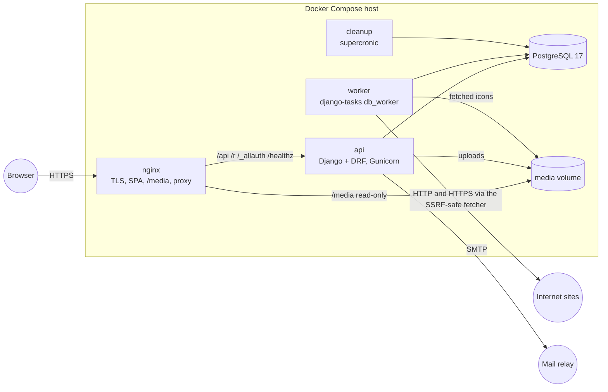
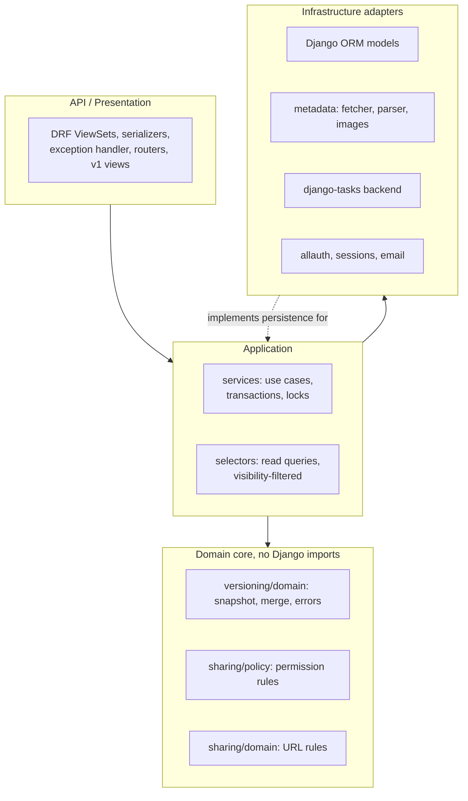
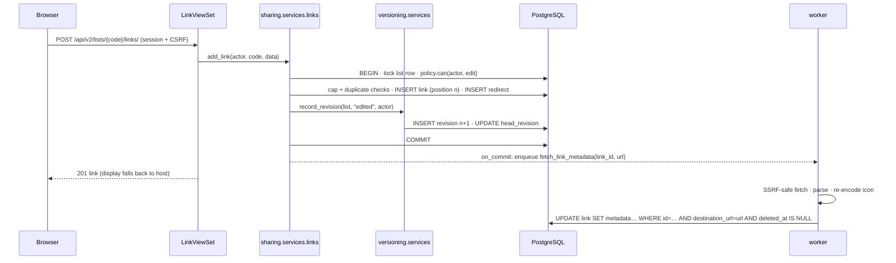

# 03: Architecture

V2 stays a **modular monolith**: one Django project, one PostgreSQL database, one SPA. It
evolves V1's layering instead of replacing it ([ADR-002](adr/ADR-002-modular-monolith.md)).
It adds exactly one new process type, a background worker for metadata extraction
([ADR-008](adr/ADR-008-background-metadata-extraction.md)).

## System context and runtime components



| Component | Status | Responsibility |
|---|---|---|
| nginx | V1, extended | TLS, the SPA, security headers and CSP, `/media/` (new), routes `/_allauth/` (new) |
| api | V1, extended | HTTP API, short URLs, auth, all writes |
| worker | **new** | Metadata fetching and image processing. The same image as api (`python manage.py db_worker`) |
| cleanup | V1, extended | Scheduled jobs: expired lists and the throttle cache, sessions (`clearsessions`), task results, stuck tasks (every 5 minutes), erased accounts, unused media (weekly) |
| db | V1 | All state, including sessions, the rate-limit cache and the task queue |
| media volume | **new** | Re-encoded images (uploads and fetched icons) |

## Layers and dependency direction



Rules:

1. **Domain core modules import no Django or DRF.** These are `versioning/domain/*`,
   `sharing/policy.py` and `common/errors.py` (the `DomainError` base classes). They take plain data (dataclasses and dicts) and return plain data or
   raise domain errors. A test walks their AST and fails on forbidden imports (roadmap task
   3.1), which is cheaper than adding an import-linter dependency.
2. `sharing/domain.py` (V1) reads Django settings for the host denylist. It stays as is. When
   touched, settings are passed in as arguments so the module becomes pure. That change isn't
   worth a PR on its own.
3. Views do HTTP only: parse, call one service or selector, serialize. They contain no
   business rules (V1 already follows this).
4. Services own transactions and row locks. They are the only writers of their app's models.
   Another app calls the service, never the model's `save()`.
5. Selectors own reads and always start from `policy.visible_lists_q(actor)` (or the group
   variant) for anything user-facing.
6. No generic repository layer. The ORM is the persistence abstraction (V1 decision, kept).
   Where the domain needs data, a use-case-specific loader returns plain values, for example
   `versioning.selectors.load_snapshot(list_id, number) -> Snapshot`. That is the only
   "repository" the merge engine knows (prompt 7.4).

## Modules

```text
backend/
  common/       errors.py: framework-free DomainError classes (not a Django app)
  apps/
    accounts/   User (AbstractUser, email login, UUID key, suspended_at), auth backends, allauth adapter,
                services (deletion grace, restore, suspension) · ViewSets /api/v2/session|me|restore
    sharing/    SharedList, SharedLink, ListMembership
                domain.py (URL rules, V1) · policy.py (pure permissions) · tokens.py (V1) · selectors.py (Principal, access)
                services/ (lists, links, members, forks, restore, media, metadata, moderation)
                v2/ (ViewSets for lists, links, images, revisions, members, the directory)
                throttling.py (rate limits shared with groups and accounts; the V1 API went in 9.6)
    shortener/  codes, ShortRedirect, /r/ (resolution adds the visibility check)
    groups/     Group, GroupList, GroupMembership · services · selectors · ViewSets (groups, the group directory, tags)
    versioning/ domain/{snapshot,diff}.py (pure) · models · services (record_revision) · selectors
    metadata/   fetcher.py (SSRF-safe) · parser.py · extraction.py · images.py (Pillow) · tasks.py (the only queueing point)
  config/       settings (auth, sessions, CSRF, TASKS, MEDIA, email, logging), urls (v1 + v2 + /_allauth/ + docs),
                exceptions.py (DomainError → HTTP; `code` on /api/v2/ error bodies), middleware, logging.py, docs.py
```

The revision endpoints live in `sharing/v2/views.py` next to the list they belong to; they call
`versioning` selectors and `sharing.services.restore`. Fetched metadata is stored through
`sharing/services/metadata.py`, so `metadata` never writes `sharing`'s tables. The merge
engine (`versioning/domain/merge.py`) is postponed with synchronization
([ADR-015](adr/ADR-015-postpone-synchronization.md)).

## Key interactions

**Read a list (anonymous):**
`GET /api/v2/lists/{code}/` → `ListViewSet.retrieve` → `selectors.get_list_for(actor, code)`,
which runs one query with the visibility filter and the actor's role annotation. Not visible →
`NotVisible` → 404. Then the serializer adds `permissions` from `policy`.

**Add a link (editor):**



**Sync apply:** see [08 Apply algorithm](08-SYNCHRONIZATION-SPEC.md#apply-algorithm).

## CQRS, pragmatically

Commands go through services. Queries go through selectors and use annotated querysets, for
example the active short code by subquery (V1 pattern), the role of the actor, and the link
count. There is no separate read model, read database or event bus (prompt 7.5). The only
derived read structure is the stored search vector (a generated column) for the directory.

## Frontend architecture (summary)

The Vue 3 + Vuetify 4 SPA is extended, not rewritten. Composables hold state and a typed API
client is split by resource. New views cover account, groups, history and explore; the sync view is
postponed ([ADR-015](adr/ADR-015-postpone-synchronization.md)).
Details are in [10-FRONTEND-ARCHITECTURE.md](10-FRONTEND-ARCHITECTURE.md).

## Why this shape

| Decision | Alternative considered | Reason |
|---|---|---|
| Keep the monolith | Separate services for shortener, sync and metadata | One team, one database, transactional invariants across lists and revisions. Splitting would need distributed transactions, which the prompt names as a thing to avoid |
| Pure core only for merge, snapshots and policy | Full hexagonal layering everywhere (repositories, DTOs, ports) | Most use cases are simple CRUD under a lock, and the ORM serves them well. The pure core sits exactly where correctness risk is high and exhaustive unit tests pay off |
| Revision writes inside the mutation transaction | Signals or after-commit hooks | Atomicity (R1) is the requirement. Signals hide control flow and can't make a failed mutation skip a revision |
| One worker type, PostgreSQL-backed | Celery + Redis | One low-volume background workload. The database already exists ([ADR-008](adr/ADR-008-background-metadata-extraction.md)) |
| ViewSets for v2 | Keep APIViews | Standard DRF routing, actions for fork, sync and restore, and consistent permission hooks. The prompt asks for ViewSets ([ADR-010](adr/ADR-010-viewsets-and-api-v2.md)) |
