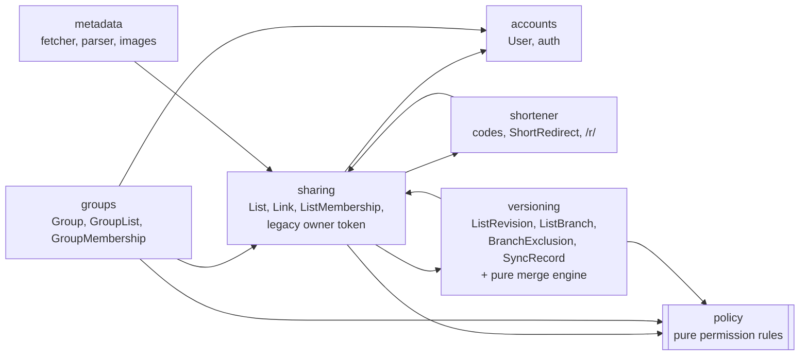
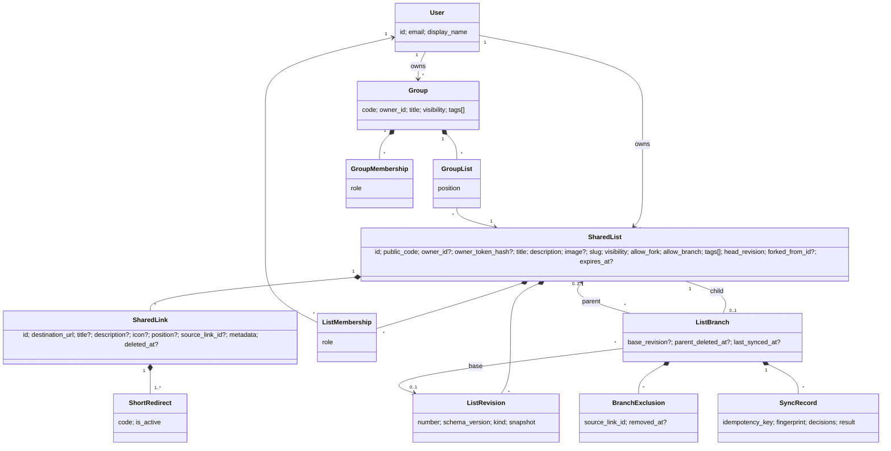

# 04: Domain model

The V2 domain is the prompt's baseline (prompt Part 5), checked against V1. Each change from
that baseline is justified in [Deviations](#deviations-from-the-proposed-baseline). Physical
columns, constraints and indexes are in [05-DATABASE-DESIGN.md](05-DATABASE-DESIGN.md), and
both documents use the same names.

## Context map

Each bounded context is one Django app. The arrows show allowed calls (service or selector
calls, never direct model writes).

`sharing` ↔ `versioning` is the one mutual dependency. `sharing` services call
`versioning.services.record_revision()` inside their transactions, and `versioning` services
call `sharing` services to apply merges. This is deliberate. Splitting it further would only
move the same coupling behind an interface. ([03-ARCHITECTURE.md](03-ARCHITECTURE.md) explains
the import rules that keep the cycle at the service level, never at the model level.)

## Aggregates and consistency boundaries

| Aggregate (root) | Contains | Consistency mechanism |
|---|---|---|
| **List** (`SharedList`) | Links, ListMemberships, the legacy owner token, ListRevisions (append-only), its own ListBranch row as a child, BranchExclusions and SyncRecords of that branch | Every write takes `SELECT … FOR UPDATE` on the list row (V1's `_lock_active_list` pattern), then re-checks state and authorization |
| **Group** (`Group`) | GroupList entries, GroupMemberships | `SELECT … FOR UPDATE` on the group row |
| **User** | Account data. allauth owns email addresses and sessions | Django auth |

A Link is not an aggregate root. Its identity is global (UUID), but its consistency rules
(unique URL, contiguous positions, the link cap, revision content) belong to its List. Each
operation locks exactly **one** aggregate row. The exceptions are "move link to another list"
and "add list to group", which lock rows in ascending `id` order to rule out deadlocks [R9].

## Entities

### List (`sharing.SharedList`)

Its stable identity is `id` (UUIDv4) plus `public_code` (16 characters, 96 bits, immutable).
Its title, description, image, slug, visibility, fork and branch permissions, tags and expiry
are mutable.

- **Owner:** `owner_id`, which is authoritative and never duplicated in memberships. A legacy
  list has `owner_id = NULL` and is managed by `owner_token_hash` until claimed.
- **Content** = title + description + the ordered live Links. Content is what revisions
  capture. Settings (visibility, members, `allow_*`, tags, image, expiry, slug) are not
  versioned ([07](07-REVISION-SPEC.md#what-a-snapshot-contains)).
- **Expiry:** `expires_at` NULL means permanent. Expired lists answer 410 to everyone (V1
  semantics) and are purged by `cleanup`.
- **Provenance:** a fork records `forked_from_id` (informational, no FK). A branch is a
  `ListBranch` row on the child.

### Link (`sharing.SharedLink`)

Its identity is `id`. The **URL is mutable data** [Decision]. Editing it keeps the `id`, the
list, the short code, `source_link_id` and the history.

- User-entered fields: `destination_url`, `title`, `description`, `icon` (uploaded image). Only
  these are versioned and synchronized.
- Fetched fields: `metadata` (JSON: title, description, site name, icon and image paths, status)
  and `metadata_fetched_at`. They are written only by the metadata worker and **never
  overwrite user fields**. Display precedence is `title ?? metadata.title ?? host`. Since
  task 7.3 the JSON is `{link_url, status: ready|unavailable, title, description, site_name,
  icon, image, final_url, error}`, and its values count only while `link_url` is the link's
  current URL, so a URL edit never shows the old page's details. Storing is a conditional
  UPDATE in `sharing.services.metadata.store` (the app that owns links), called by the
  worker's task; it writes no revision and leaves `updated_at` alone.
- `position`: 0-based order among live links. `deleted_at`: tombstone; a deleted link has
  `position = NULL`, its short URL answers 404, and restoring a revision revives the same row.
- `source_link_id`: the parent Link's `id` it was copied from. A plain UUID with no FK, so it
  survives deletion of the parent row or list [Decision].

### ShortRedirect (`shortener.ShortRedirect`)

V1's code → Link mapping is unchanged. List and Group codes are columns on their own rows, so
there is no polymorphic ShortURL table ([ADR-006](adr/ADR-006-url-shortening-strategy.md)).

### ListMembership / GroupMembership

`(resource, user, role)` with role EDITOR or VIEWER, unique per (resource, user). OWNER is
represented only by `owner_id`. Group membership grants rights on the group, **never** on the
lists in it.

### ListRevision, ListBranch, BranchExclusion, SyncRecord

> **Postponed** ([ADR-015](adr/ADR-015-postpone-synchronization.md), 2026-10-29): `ListBranch`, `BranchExclusion` and `SyncRecord` (and the merge services and the B-invariants below) are not built in V2. `ListRevision` is. The model is kept as the design.

See [07](07-REVISION-SPEC.md) and [08](08-SYNCHRONIZATION-SPEC.md). In short:

- A revision is immutable and is the authoritative history of a list's content.
- `ListBranch` exists only for branches (not forks). The child has exactly one row, and the
  row tracks the parent revision used as the baseline.
- `BranchExclusion` holds a persistent "ignore source link X" rule, with `removed_at` marking a
  re-inclusion that is still pending.
- `SyncRecord` holds one applied merge: the idempotency key, the fingerprint, the decisions and
  the result.

### Group, GroupList

A Group is an ordered portal of Lists with its own code (`/g/{code}`), owner, visibility,
members and tags. `GroupList(group, list, position)` is unique per (group, list). A Group
never copies Links.

## Value objects

| Value object | Rules |
|---|---|
| `Code` | 16 Base64URL characters from `secrets` (96 bits). Unique per kind through a DB constraint |
| `NormalizedUrl` | V1 `normalize_destination_url`: http/https only, no credentials, ≤2048 UTF-8 bytes, punycode host, default port dropped, host policy |
| `Visibility` | `private` · `unlisted` · `public` |
| `Role` | `editor` · `viewer` (owner is not a role value) |
| `Tag` | `^[a-z0-9]+(-[a-z0-9]+)*$`, ≤32 characters, ≤10 per list or group, stored lowercase |
| `Slug` | A display-only slugified title (≤80 characters). Not unique and never resolved ([09](09-API-DESIGN.md#urls-and-slugs)) |
| `Snapshot` | Versioned JSON document of list content ([07](07-REVISION-SPEC.md#snapshot-schema-v1)) |
| `LinkState` | `{id, source_link_id, url, title, description, icon, position}` inside a snapshot |
| `MergeDecision` | `accept` · `keep_local` · `exclude` |
| `ChangeId`, `Fingerprint` | Deterministic SHA-256 identifiers of proposed changes and of a preview ([08](08-SYNCHRONIZATION-SPEC.md#identifiers-fingerprints-and-idempotency)) |

## Invariants

Tests refer to these IDs ([15](15-TEST-STRATEGY.md)). Where the database can enforce one, it
does ([05](05-DATABASE-DESIGN.md#constraints-by-invariant)).

**List**
- **L1** `id` and `public_code` never change.
- **L2** Every list has a manager: `owner_id IS NOT NULL OR owner_token_hash IS NOT NULL`.
- **L3** A legacy list (`owner_id IS NULL`) is `unlisted` and has an `expires_at`.
- **L4** At most `MAX_LINKS_PER_LIST` (100, a setting) live links.
- **L5** An expired list is inaccessible to everyone (410) and is never resurrected by expiry
  edits after the fact.
- **L6** The owner never has a membership row on their own list.

**Link**
- **K1** Changing a URL never creates a new Link. `id`, list, short code and `source_link_id`
  are preserved.
- **K2** Live URLs are unique per list after normalization.
- **K3** Live positions are exactly `0..n-1`. Deleted links have `position = NULL`.
- **K4** A Link never changes list. "Move to another list" is copy + delete in one transaction.
- **K5** `source_link_id` is set at creation (branch, fork or merge ACCEPT) or by the
  merge-adopt rule, and never changed otherwise.
- **K6** Background metadata never writes user-entered fields.

**Revision**
- **R1** Each committed content change produces exactly one revision in the same transaction.
  A no-op produces none.
- **R2** Revision numbers per list are contiguous from 1, assigned under the list lock.
- **R3** Revisions are never updated (enforced by a DB trigger) and are deleted only with their
  list.
- **R4** The head revision's snapshot equals the live content.
- **R5** Restoring writes a new revision. It never moves the head backwards.

**Branch**
- **B1** A list has at most one parent (`UNIQUE(child_list_id)`).
- **B2** There are no ancestry cycles. Branches are created only as new child lists, and
  re-parenting does not exist.
- **B3** Synchronization never writes the parent.
- **B4** A child changes only through explicit decisions on a fresh preview.
- **B5** `base_revision` belongs to the parent and only moves forward.
- **B6** The child survives deletion or expiry of the parent.
- **B7** Exclusions are keyed by source link identity, never by URL.

**Group**
- **G1** A list appears at most once per group, and at most 100 lists per group. Positions are
  unique and ordered. Deleting a list can leave a gap, which the group's next write closes;
  nothing ever reads a raw position (order and indexes are computed after the display rule).
  Whether to keep positions strictly `0..n-1` instead is open question
  [Q17](20-DECISIONS-AND-OPEN-QUESTIONS.md), postponed to the end of V2.
- **G2** A group never grants access to a list and never copies its content.

**Access and short URLs**
- **A1** Every object access goes through the permission policy. Querysets are filtered in SQL.
- **A2** Unauthorized access to a private resource answers 404 (no existence leak).
- **A3** A legacy owner token grants V1-equivalent rights on its own list only.
- **S1** Codes never change and are never intentionally reused.
- **S2** Short URL resolution re-checks the list's state and visibility on every request.

## Domain services and where they live

| Service | Kind | Location |
|---|---|---|
| Snapshot builder and validator | Pure functions | `versioning/domain/snapshot.py` |
| Diff and merge engine (`compute_plan`, `apply_decisions`) | Pure functions over snapshots | `versioning/domain/merge.py` |
| Permission policy (`can(actor, action, resource) -> bool`, `visible_lists_q(actor)`) | Pure rules plus one Q-builder | `sharing/policy.py` (shared by `groups` and `versioning`) |
| URL normalization and host policy | Existing functions | `sharing/domain.py` |
| Revision recording | Application service | `versioning/services.py` |
| List and link mutations, restore, fork | Application services | `sharing/services/` (`lists`, `links`, `restore`, `forks`): they write lists and links, and call `record_revision` |
| Branch, preview and apply (postponed) | Application services | `versioning/services.py` |
| Metadata fetch, parse, image processing | Infrastructure adapters plus a task | `metadata/` |

The prompt's illustrative operations map to concrete functions:

| Prompt operation | V2 function |
|---|---|
| `create_revision()` | `versioning.services.record_revision(list, kind, actor)`, called inside every content mutation |
| `restore_revision()` | `sharing.services.restore.restore_revision(principal, list_id, number, expected_head=…)` |
| `create_branch()` / `create_fork()` | `versioning.services.create_branch(...)` (postponed) / `sharing.services.forks.fork_list(principal, code, title=…, creation_key=…)` |
| `calculate_diff()` | `versioning.domain.merge.compute_plan(base, parent, child, exclusions, reincluded)` |
| `preview_merge()` / `apply_merge()` | `versioning.services.preview_sync(...)` / `apply_sync(...)` |
| `add_exclusion()` / `remove_exclusion()` | Created by the EXCLUDE decision / `versioning.services.remove_exclusion(...)` |
| `get_sync_status()` | `versioning.selectors.sync_status(child, actor)` |

## Domain events

None [Decision]. Every reaction is a direct call inside the same transaction: the revision with
its mutation, and branch rows with list deletion. The one asynchronous effect, metadata
fetching, is enqueued with `transaction.on_commit`, so a rolled-back mutation never schedules
work. An event bus would add indirection without solving a present problem (prompt 1.3 YAGNI).

## Ownership rules

- A list or group has exactly one owner account (legacy lists: a token).
- Ownership is never assigned implicitly. It comes from creation (the creator), from a claim
  (proof of token plus a signed-in user), or later from an explicit transfer
  ([02](02-PRODUCT-REQUIREMENTS.md): transfer is "later").
- Deleting an account needs an explicit decision about owned lists. Since
  [ADR-016](adr/ADR-016-account-deletion-grace-period.md): deleting hides the user's lists from
  everyone at once and ends every session; signing in within 30 days restores everything;
  after that the lists and memberships are deleted and the account's personal data erased,
  keeping an anonymous, inactive row so revisions keep their author. The owner FK stays
  `PROTECT`; user rows are no longer deleted.

## Deviations from the proposed baseline

| Proposed (prompt Part 5) | V2 decision | Why |
|---|---|---|
| `List.deleted_at`, `Group.deleted_at` | **Hard delete** (as in V1); `ListBranch.parent_deleted_at` records parent deletion | A soft-deleted list or group must be filtered out of every query and every leak path, which is a standing authorization risk, for an undo feature nobody asked for. Children keep their own history ([ADR-013](adr/ADR-013-soft-delete-links-only.md)) |
| `Link.deleted_at` | Kept (tombstone) | Identity, short-code revival and revision restore need it |
| `List.slug` unique | Display-only, non-unique | Avoids squatting, collisions, reserved names and broken links |
| `ShortURL` with `LIST/GROUP/LINK/EXTERNAL_URL` | Codes on rows plus `ShortRedirect` for links; EXTERNAL_URL deferred | Real FKs instead of a generic reference. An anonymous-style external shortener is an open-redirect and phishing magnet ([ADR-006](adr/ADR-006-url-shortening-strategy.md)) |
| (none) | `head_revision`, `creation_key`, `tags[]`, `forked_from_id` on List | Revision numbering under lock, idempotent creation, directory filtering, attribution |
| (none) | `SyncRecord`, `BranchExclusion.removed_at`, `ListBranch.parent_deleted_at` | Idempotent apply and audit, exact re-inclusion semantics, a clear status after parent deletion |
| `Link.icon` | User-uploaded icon path; fetched icon in `metadata` | Field provenance (prompt 9.4) |
