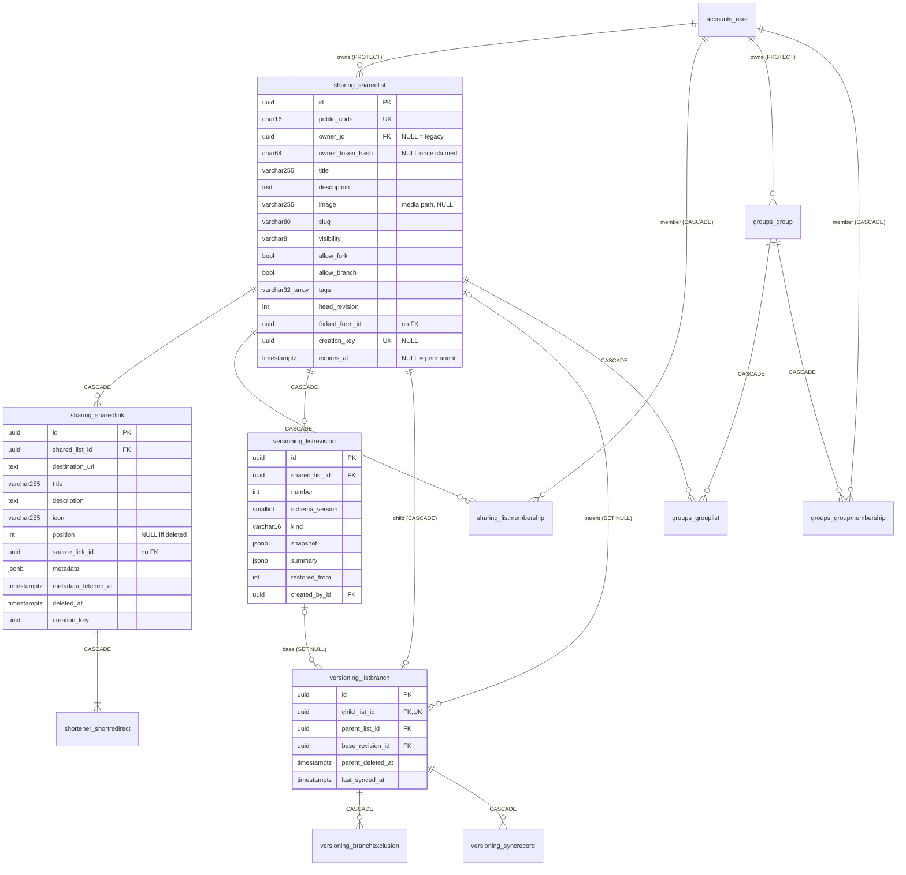

# 05: Database design

There is one PostgreSQL 17 database, which is the single source of truth (prompt 7.5). Names
match [04-DOMAIN-MODEL.md](04-DOMAIN-MODEL.md). New columns and tables arrive in the phases of
[17-IMPLEMENTATION-ROADMAP.md](17-IMPLEMENTATION-ROADMAP.md). The V1 → V2 steps are in
[06-MIGRATION-PLAN.md](06-MIGRATION-PLAN.md).

## ER diagram

`created_at` and `updated_at` exist on every table and are omitted from the diagram.

## Tables

All primary keys are UUIDv4 (V1 convention). Django 6's `BigAutoField` default doesn't apply
because every model declares its own key. Time columns are `timestamptz`, in UTC.

### `sharing_sharedlist` (existing, extended)

| Column | Type | Null | Default | Notes |
|---|---|---|---|---|
| `id`, `public_code`, `title`, `created_at`, `updated_at` | as in V1 | | | unchanged |
| `owner_token_hash` | char(64) | **yes** (was NOT NULL) | | legacy only; set to NULL on claim |
| `expires_at` | timestamptz | **yes** (was NOT NULL) | | NULL = permanent; index kept |
| `owner_id` | uuid FK `accounts_user` | yes | | `ON DELETE PROTECT`; index |
| `description` | text | no | `''` | ≤1000 characters (validated) |
| `image` | varchar(255) | yes | | relative media path |
| `slug` | varchar(80) | no | `''` | cosmetic, not unique |
| `visibility` | varchar(8) | no | `db_default 'unlisted'` (migration), model default `'private'` | CHECK in (`private`,`unlisted`,`public`) |
| `allow_fork`, `allow_branch` | boolean | no | false | |
| `tags` | varchar(32)[] | no | `'{}'` | CHECK `cardinality(tags) <= 10`; GIN index (phase 8) |
| `head_revision` | integer | no | 0 | CHECK `>= 0`; written under the row lock |
| `forked_from_id` | uuid | yes | | attribution only |
| `creation_key` | uuid | yes | | UNIQUE (nulls distinct); idempotent create, fork and branch |

### `sharing_sharedlink` (existing, extended)

| Column | Type | Null | Default | Notes |
|---|---|---|---|---|
| `id`, `shared_list_id`, `destination_url`, `title`, `created_at`, `updated_at` | as in V1 | | | |
| `description` | text | yes | | ≤1000 characters |
| `icon` | varchar(255) | yes | | user-uploaded icon path |
| `position` | integer | yes | | CHECK `position >= 0` |
| `deleted_at` | timestamptz | yes | | tombstone |
| `source_link_id` | uuid | yes | | no FK on purpose |
| `metadata` | jsonb | no | `'{}'` | fetched values only ([ADR-008](adr/ADR-008-background-metadata-extraction.md)) |
| `metadata_fetched_at` | timestamptz | yes | | |
| `creation_key` | uuid | yes | | UNIQUE (`shared_list_id`, `creation_key`) |

Constraints:

- `sharing_link_live_destination_uniq`: **unique index** on (`shared_list_id`,
  `destination_url`) `WHERE deleted_at IS NULL`. It replaces V1's
  `sharing_link_destination_per_list_uniq`.
- `sharing_link_position_uniq`: UNIQUE (`shared_list_id`, `position`) **DEFERRABLE INITIALLY
  DEFERRED**, so a reorder can shift several rows in one statement and is checked at commit.
  NULL positions (deleted links) don't collide. This can't be a partial constraint, because
  Django refuses `condition` together with `deferrable`
  ("UniqueConstraint with conditions cannot be deferred", **[Verified]** against Django 5.2.18
  in the V1 image). That's why deleted links get `position = NULL` instead of a filter.
- `sharing_link_tombstone_position`: CHECK `(deleted_at IS NULL) = (position IS NOT NULL)`.
- `sharing_link_live_source_uniq`: **unique index** on (`shared_list_id`, `source_link_id`)
  `WHERE source_link_id IS NOT NULL AND deleted_at IS NULL`. A child holds at most one live
  copy of a source link, which is what the merge's identity mapping relies on
  ([08](08-SYNCHRONIZATION-SPEC.md#merge-inputs)).

### `shortener_shortredirect` (unchanged)

V1's unique `code` and FK to the link with CASCADE are kept. The cascade now fires only when a
whole list is purged. Soft-deleting a link keeps its redirect, so resolution answers 404 while
the link is deleted and works again if the link is revived.

### `sharing_listmembership` (new)

`id`, `shared_list_id` FK CASCADE, `user_id` FK CASCADE, `role` varchar(8) CHECK in
(`editor`,`viewer`), `added_by_id` FK SET NULL, `created_at`. UNIQUE (`shared_list_id`,
`user_id`). Index on `user_id` (for "shared with me"). L6 (the owner is not a member) is
enforced in the service.

### `accounts_user` (new, `accounts/0001_initial`)

`AbstractUser` subclass with `username` removed, `email` as `USERNAME_FIELD`, a unique index on
`lower(email)`, and `display_name` varchar(80). allauth adds its own tables (email addresses,
confirmations), and `django.contrib.sessions` adds `django_session`.

### `groups_group`, `groups_grouplist`, `groups_groupmembership` (new)

- `groups_group`: `id`, `code` char(16) UNIQUE, `owner_id` FK PROTECT, `title`, `description`,
  `image`, `slug`, `visibility` (CHECK), `tags` (CHECK ≤10), `created_at`, `updated_at`.
- `groups_grouplist`: `id`, `group_id` FK CASCADE, `shared_list_id` FK CASCADE, `position` int
  NOT NULL CHECK ≥0, `added_by_id` FK SET NULL, `created_at`. UNIQUE (`group_id`,
  `shared_list_id`). UNIQUE (`group_id`, `position`) DEFERRABLE INITIALLY DEFERRED. Index on
  `shared_list_id`.
- `groups_groupmembership`: same shape as `sharing_listmembership`.

### `versioning_*` (new)

| Table | Columns | Constraints and indexes |
|---|---|---|
| `versioning_listrevision` | `id`, `shared_list_id` FK CASCADE, `number` int, `schema_version` smallint, `kind` varchar(16) CHECK in (`created`,`edited`,`restored`,`merged`,`branched`,`forked`,`migrated`), `snapshot` jsonb, `summary` jsonb, `restored_from` int NULL, `created_by_id` FK SET NULL, `created_at` | UNIQUE (`shared_list_id`, `number`); CHECK `number >= 1`; trigger `versioning_revision_immutable` raises on UPDATE |
| `versioning_listbranch` | `id`, `child_list_id` FK CASCADE **UNIQUE**, `parent_list_id` FK SET NULL, `base_revision_id` FK SET NULL, `parent_deleted_at`, `created_at`, `last_synced_at` | CHECK `parent_list_id <> child_list_id`; index on `parent_list_id` |
| `versioning_branchexclusion` | `id`, `branch_id` FK CASCADE, `source_link_id` uuid, `removed_at` NULL, `created_by_id` FK SET NULL, `created_at` | UNIQUE (`branch_id`, `source_link_id`) |
| `versioning_syncrecord` | `id`, `branch_id` FK CASCADE, `idempotency_key` uuid, `request_hash` char(64), `fingerprint` char(64), `base_revision_number`, `parent_revision_number`, `child_revision_before`, `child_revision_after` NULL, `decisions` jsonb, `result` jsonb, `created_by_id` FK SET NULL, `created_at` | UNIQUE (`branch_id`, `idempotency_key`) |

### Infrastructure tables

`rate_limit_cache` (V1, `createcachetable`), `django_session`, allauth tables, and the
django-tasks-db task table ([ADR-008](adr/ADR-008-background-metadata-extraction.md)).

## Constraints by invariant

| Invariant | Enforced by |
|---|---|
| L1 stable identity | no update path in services; `editable=False`; serializers read-only |
| L2 every list managed | CHECK `owner_id IS NOT NULL OR owner_token_hash IS NOT NULL` |
| L3 legacy lists | CHECK `owner_id IS NOT NULL OR (visibility = 'unlisted' AND expires_at IS NOT NULL)` |
| L4 link cap | count under the list lock (V1 pattern, concurrency-tested) |
| K2 unique live URLs | partial unique index |
| K3 positions | deferrable unique + tombstone CHECK + renumbering under the lock |
| R2/R3 revisions | UNIQUE (list, number) + lock + UPDATE trigger |
| B1 single parent | UNIQUE `child_list_id` |
| B2 no cycles | no re-parenting code path; CHECK parent ≠ child |
| G1 group entries | UNIQUE (group, list), deferrable UNIQUE (group, position) |
| S1 codes | UNIQUE constraints + `create_with_unique_code` retry |
| idempotency | UNIQUE `creation_key`, UNIQUE (branch, idempotency_key) |

## Deletion semantics

| Event | Effect |
|---|---|
| Delete a list | Hard delete. CASCADE to links, redirects, memberships, revisions, its own `ListBranch` (as child), exclusions, sync records and `GroupList` rows. Before deleting, the service sets `parent_deleted_at = now()` on branches whose parent it is; then `parent_list_id` and `base_revision_id` become NULL |
| A list expires | 410 for every request from `expires_at` on. `cleanup` purges it like a delete |
| Delete a link | Soft: `deleted_at = now()`, `position = NULL`, later positions shift down, the redirect stays (404 while deleted) |
| Revive a link (restore or merge ACCEPT) | `deleted_at = NULL`, position assigned; same `id` and short code |
| Delete a group | CASCADE to `GroupList` and memberships. Lists are untouched |
| Delete a user | PROTECT while they own lists or groups (the account-deletion flow deletes those first). Memberships CASCADE. `created_by`/`added_by` SET NULL |

Tombstoned links are kept as long as their list exists, because older revisions reference
them. Their cost is one small row each, and lists are capped at 100 live links.

## Transaction boundaries

Every row below is one `transaction.atomic` block. "Lock" means `SELECT … FOR UPDATE` on the
aggregate row before any read that informs the write.

| Use case | Lock | Writes in the same transaction |
|---|---|---|
| Create list | none (new row) | list (code retried in a savepoint) + revision 1 `created` |
| Update content (title, description) | list | list + revision `edited` (skipped if unchanged) |
| Update settings (visibility, members, tags, image, expiry, `allow_*`) | list | list or membership rows only, no revision |
| Add / update / delete / move link | list | link rows (+ redirect on add) + revision; metadata enqueued `on_commit` |
| Move link to another list | both lists, ascending `id` | copy in target + tombstone in source + one revision in each |
| Restore revision | list | links (revive, update, tombstone, reposition) + revision `restored` |
| Create fork or branch | none on the parent (reads its immutable head revision) | child list + links + redirects + revision 1 (`forked`/`branched`) + `ListBranch` for branches |
| Apply sync | child list | child links + revision `merged` (if content changed) + `ListBranch` base + exclusions + `SyncRecord` |
| Claim legacy list | list | `owner_id`, `owner_token_hash = NULL`, `visibility` unchanged |
| Store fetched metadata | none | conditional `UPDATE … WHERE id = ? AND destination_url = ? AND deleted_at IS NULL` |
| Group writes | group | group, entries or memberships |
| Delete list | list | branch rows (`parent_deleted_at`) + cascade |

The isolation level stays PostgreSQL's default, **Read Committed**. Every read-modify-write
happens after the row lock, which serializes writers per aggregate. Merges and branch creation
read immutable revision snapshots, so they never see a half-applied state. Repeatable Read or
Serializable would add retry handling (SQLSTATE `40001`) without protecting anything the locks
don't already cover [R10].

## Concurrency controls

| Mechanism | Used for | Why this one |
|---|---|---|
| Row lock on the aggregate (`FOR UPDATE`) | every list or group write | short server-side read-modify-write (cap, positions, revision numbers). Writes per list are rare, so serializing them costs nothing (V1 experience) |
| Optimistic precondition (`If-Match: "r{head_revision}"` → 412) | required on restore and sync apply; optional on other content writes | the user decided based on a state they looked at, so a lock can't help. Detect staleness instead ([09](09-API-DESIGN.md#concurrency-preconditions)). Reorder needs none: it is a *move* applied to the current order under the lock |
| Unique constraints | codes, URLs, positions, revision numbers, child uniqueness, idempotency keys | last line of defence. A violation is a 409, never a 500 |
| Advisory locks | throttle histories (xact), `cleanup` single run (session) | already proven in V1 |
| `SKIP LOCKED` | task queue claims in the worker | provided by django-tasks-db (`skip_locked` in its models, **[Verified R5]** by code search) |
| Deadlock avoidance | the two-row operations above lock in ascending `id` order | PostgreSQL docs' primary advice [R9] |

## Indexes added by V2

| Table | Index | Serves |
|---|---|---|
| sharedlist | `owner_id`; btree (`updated_at` DESC) `WHERE visibility = 'public'`; GIN (`tags`); GIN on a generated `search` tsvector (phase 8) | "My lists", the directory, tag filters, search |
| sharedlink | partial unique (list, URL) live; deferrable unique (list, position); partial unique (list, `source_link_id`) live | uniqueness, ordering, merges |
| listmembership / groupmembership | (`user_id`) | "Shared with me" |
| listrevision | UNIQUE (list, number) | history pages, head lookup |
| listbranch | `parent_list_id` | "synced copies of this list" |
| grouplist | `shared_list_id` | groups containing a list |

Search uses a stored generated column, `GeneratedField(SearchVector(title, description,
config='simple'), db_persist=True)`, with a GIN index and `pg_trgm` for prefix and fuzzy
title matching, which needs `TrigramExtension` [R11]. The `simple` configuration avoids
language-specific stemming on mixed-language titles. **[Assumption]** Django can express this
generated column for a `simple`-config vector. Verify in roadmap task 8.1; the fallback is a
trigger-maintained `SearchVectorField` [R11].

## Size and performance assumptions

- Lists: up to the low hundreds of thousands. Links: ≤100 live per list.
- A snapshot is about 0.3 KB per link, so ~30 KB for a full list, and ~250 KB worst case with
  2 KB URLs. PostgreSQL TOAST-compresses JSONB. One revision per content change, at a few
  revisions per list per day, is negligible. A retention policy is deferred
  ([20](20-DECISIONS-AND-OPEN-QUESTIONS.md)).
- Every hot read is index-backed: a list by code, links by (list, position), revisions by (list,
  number), the directory by partial index plus GIN.
