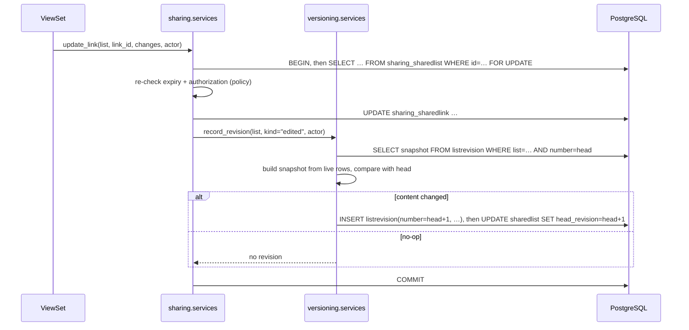

# 07: Revision specification

Every List has an immutable, numbered history of full content snapshots, stored in PostgreSQL
JSONB ([ADR-003](adr/ADR-003-immutable-revision-snapshots.md)). Revisions are the source of
truth for history, restore, branch creation and the three-way merge
([08](08-SYNCHRONIZATION-SPEC.md)).

## Why full snapshots

| Option | Verdict |
|---|---|
| **Full JSON snapshots** | **Chosen.** Any revision can be read or restored in one row read, with no replay. Snapshots are the BASE, PARENT and CHILD inputs the merge engine needs. A list is capped at 100 links, so a snapshot is ~30 KB at most in normal use and TOAST-compressed |
| Change records (deltas) | Smaller, but every read replays a chain, and a bug in one delta corrupts all later states. That fragility doesn't fit the highest-risk subsystem |
| Event sourcing | Replaces the relational model as the source of truth, which needs projections, upcasting and rebuild tooling. That's a rewrite of the app's foundation, and the prompt forbids it without a compelling reason. There isn't one |
| Hybrid (periodic snapshots + deltas) | An optimization for large documents. Revisit only if snapshots grow beyond ~1 MB, which the link cap rules out |

The live tables (`sharing_sharedlist`, `sharing_sharedlink`) stay the source of truth for
*current* state, which keeps queries, constraints, short URLs and V1 code working. Invariant
**R4** keeps the head revision equal to the live state.

## What a snapshot contains

A snapshot holds **content**: the list title, the description, and the ordered live links with
their user-entered fields.

It holds **no settings or presentation**: visibility, members, `allow_fork`, `allow_branch`,
tags, list image, slug and expiry. Changing those writes no revision, because restoring an old
revision should never silently change who can see a list. Fetched metadata is excluded too, as
are timestamps, short codes (they belong to the link `id`) and tombstoned links (they appear in
the revisions in which they were alive).

### Snapshot schema v1

```json
{
  "schema_version": 1,
  "list": { "title": "Dev tools", "description": "" },
  "links": [
    {
      "id": "6f1c…",
      "source_link_id": null,
      "url": "https://github.com/",
      "title": "GitHub",
      "description": null,
      "icon": "icons/2b/2b9e….webp",
      "position": 0
    }
  ]
}
```

Rules:

- `links` holds live links only, sorted by `position`, and positions are exactly `0..n-1`.
- Strings are stored as saved after validation and normalization. `url` is the normalized
  `destination_url`.
- Empty optional fields are `null` (V1's convention: blank title → `null`). Description on the
  list is `""` when empty, matching its column.
- `schema_version` is required. Readers accept every version they know. Writers always emit the
  current one. A new version gets an upcaster function `upcast_vN_to_vN+1(snapshot)` in
  `versioning/domain/snapshot.py`, applied when an old snapshot is read. Stored rows are never
  rewritten (R3).
- Canonical form: snapshots are compared as parsed values, never as serialized text, so key
  order and whitespace don't matter.

## Numbering

- `ListRevision.number` starts at 1 per list and increases by exactly 1.
- The number is `head_revision + 1`, computed and written while the list row is locked. The
  same transaction sets `SharedList.head_revision` to the new number. UNIQUE (`shared_list_id`,
  `number`) backs this up. A violation means a bug, so it is a 500 plus an alert, never a
  silent retry.
- Revision 1 is written in the transaction that creates the list (`created`, `forked` or
  `branched`) or by the V2 data migration (`migrated`).

## Mutation rules



| Operation | Revision? | Kind |
|---|---|---|
| Create list, fork, branch | always (number 1) | `created` / `forked` / `branched` |
| Change title or description | if the value changed | `edited` |
| Add, edit or delete a link | if content changed | `edited` |
| Move or reorder a link | if order changed (moving to the same index is a no-op) | `edited` |
| Move a link to another list | one in each list | `edited` |
| Restore revision N | if the restored content differs from head | `restored` (`restored_from = N`) |
| Apply sync | if the child's content changed | `merged` |
| Change visibility, members, tags, image, expiry, slug, `allow_*` | **never** | |
| Fetched metadata arrives or is refreshed | **never** | |
| Claim a legacy list | never | |
| Failed or rolled-back mutation | never (same transaction) | |

**No-op detection** compares the rebuilt snapshot with the head snapshot. If they are equal,
nothing is written: no revision, no `updated_at` bump. This makes repeated identical requests
harmless at the history level.

**Batching:** one user action is one revision. A merge that applies 20 changes writes one
`merged` revision. `summary` records counts (`{"added": 3, "removed": 1, "modified": 2,
"moved": 0}`) for the history UI. The counts are computed by diffing the previous and new
snapshots with the same engine the merge uses.

**Authorship:** `created_by_id` is the acting user. For legacy-token writes it is NULL, and
the API presents those as "edit link".

## Restoration

`POST /api/v2/lists/{code}/restore/ {"revision": N}` with `If-Match: "r{head}"`
([09](09-API-DESIGN.md#revisions-and-restore)):

1. Lock the list. Check the precondition (412 if the head moved) and permission (editor or
   above, [12](12-AUTHORIZATION.md)).
2. Load snapshot N. Upcast if needed.
3. Make the live state equal snapshot N, link by link, keyed by `id`:
   - in N and live → update its fields and position;
   - in N and tombstoned → **revive** the same row (same `id`, short code and
     `source_link_id`). Clear `deleted_at` and set position and fields;
   - live but not in N → tombstone it;
   - in N but its row no longer exists → impossible while the list exists, because rows are
     never hard-deleted before the list. Fail with 500 and an alert if it ever happens.
   - Restoring a URL that another live link now uses is impossible, because that link is not
     in N, so it is tombstoned first. Within one transaction the order is: tombstone, then
     revive, then update.
4. Restore title and description.
5. `record_revision(kind="restored", restored_from=N)`. If the content equals head, it's a
   no-op and returns 200 with `"changed": false`.

Restoring never deletes or alters revisions after N. History only grows (R5). Restoring a
list's content doesn't touch its branch baseline; see
[08 scenario 19](08-SYNCHRONIZATION-SPEC.md#scenario-catalogue).

Fetched metadata is not restored. A revived link keeps whatever `metadata` its row still
holds, and the worker refreshes it on URL change as usual.

## Immutability

- Application: `ListRevision.save()` refuses updates, and there is no service or API that
  edits revisions.
- Database: a `BEFORE UPDATE` trigger on `versioning_listrevision` raises an exception. It is
  created by a `RunSQL` migration with a reverse. DELETE stays possible so that deleting a list
  can cascade.
- Revisions are visible to the list's owner and editors only, because history can contain
  links an owner deliberately removed ([12](12-AUTHORIZATION.md)).

## Concurrency

| Race | Outcome |
|---|---|
| Two writers on the same list | serialized by the row lock. Each gets its own revision number. There are no gaps or duplicates |
| A restore based on a stale view | 412 `revision_mismatch`. The UI reloads history |
| A writer and a reader of history | readers see committed revisions only (Read Committed) |
| A metadata worker and a manual edit | the worker never touches versioned fields, so they don't interact ([ADR-008](adr/ADR-008-background-metadata-extraction.md)) |
| Branch creation while the parent is edited | branch creation reads the parent's head revision row, which is committed and immutable. Whichever commits first, the child copies one consistent snapshot |

## Initial revisions for migrated V1 lists

The V2 migration writes revision 1, `kind = 'migrated'`, for every existing list. It holds
the state actually migrated, and its `created_at` is the migration time. No earlier history is
invented ([06](06-MIGRATION-PLAN.md#revision-initialization)). The history UI labels it
"History starts here (moved to the new version)".

## Test scenarios (minimum)

1. Every mutation in the table above writes exactly one revision, or none for no-ops and
   settings.
2. A forced failure after the link write but before commit leaves neither a link change nor a
   revision.
3. 20 concurrent edits on one list produce revisions 2..21 with no gaps or duplicates (real
   threads, PostgreSQL).
4. After every operation in a randomized sequence, the head snapshot equals the snapshot rebuilt
   from live rows (R4, property-based).
5. Restore revives tombstoned links with the same `id` and short code, and `/r/{code}` works
   again.
6. Restore with a stale `If-Match` returns 412 and changes nothing.
7. `UPDATE versioning_listrevision` fails at the database level.
8. Upcasting: a stored v1 snapshot is readable after a v2 schema is introduced (added when v2
   exists).
