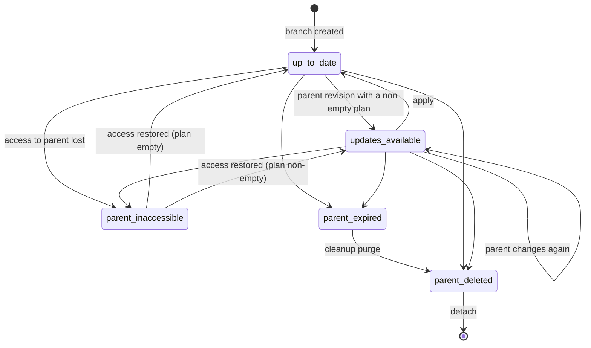

# 08: Synchronization specification

Branching and synchronization are the highest-risk part of V2. This document is normative.
The implementation (`versioning/domain/merge.py` plus `versioning/services.py`) must behave
exactly as written here. Where behaviour is unclear, fix the document first.

Ground rules ([ADR-004](adr/ADR-004-three-way-merge.md)):

- This is **not Git**. A merge has exactly one parent, operates per Link and per field, and
  happens only on request after a preview. There are no automatic merges, no pushes to the
  parent, no multi-parent merges and no re-parenting.
- Synchronization is domain logic in a pure engine over immutable snapshots
  ([07](07-REVISION-SPEC.md)). It is not CRUD.
- The parent is never written (B3). The child changes only through explicit decisions on a
  fresh preview (B4).

## Fork vs branch

| | Fork ("Make a copy") | Branch ("Make a synced copy") |
|---|---|---|
| Result | An ordinary List owned by the actor | An ordinary List owned by the actor |
| Links | Copied: new `id`, new short codes, `source_link_id` = the parent link's `id` (lineage only) | Same |
| Relationship | `forked_from_id` (attribution). **No `ListBranch` row**, so it can never receive updates | A `ListBranch(child, parent, base_revision)` row |
| Allowed when | the actor is signed in and is the owner, or can view the parent and `allow_fork` is set | the actor is signed in and is the owner, or can view the parent and `allow_branch` is set |
| Initial revision | `forked` (number 1) | `branched` (number 1) |
| Defaults | visibility `private`, `allow_fork`/`allow_branch` false, no expiry, title "{parent title} (copy)" | same |

`allow_branch` controls only **creating** branches. An existing branch keeps syncing while its
child's editors can still **view** the parent, because visibility is the real security
boundary. If the parent becomes private, or the child's owner loses membership, the status
becomes `parent_inaccessible` ([12](12-AUTHORIZATION.md#synchronization)).

## Branch creation (atomic)

`POST /api/v2/lists/{code}/branches/` (or `/fork/`) with an optional `Idempotency-Key`:

1. Authorize (above). If the key matches an existing list's `creation_key` from the same
   actor, return that list (200).
2. Read the parent's `head_revision` and that revision's snapshot in one query. The snapshot
   is immutable, so this is a consistent copy without locking the parent.
3. In one transaction: create the child list (code retry), copy every snapshot link (new `id`,
   `position` as in the parent, `source_link_id` = the parent link `id`, and `metadata` copied
   from the parent row when it still exists), create a short code per link, write revision 1,
   and for branches create `ListBranch(base_revision = parent head)`.
4. Any failure rolls everything back. There is never a half-created branch.

A list can be both a child and a parent ("nested branches"). Cycles are impossible: a branch
is always a **new** list, and no operation changes a list's parent (B2).

## Merge inputs

| Input | Source |
|---|---|
| **BASE** | the parent's snapshot at `ListBranch.base_revision`: the parent state the child last synchronized against |
| **PARENT** | the parent's head snapshot |
| **CHILD** | the child's head snapshot. It equals the live state by R4 |
| **EXCL** | active exclusions (`removed_at IS NULL`): a set of source ids |
| **REINC** | pending re-inclusions (`removed_at IS NOT NULL`): a set of source ids |

Identity mapping: BASE and PARENT links are keyed by their own `id`. CHILD links are keyed by
`source_link_id`. A child holds at most one live link per source (a unique partial index on
(`shared_list_id`, `source_link_id`) for live links; see
[05](05-DATABASE-DESIGN.md#sharing_sharedlink-existing-extended)). Two kinds of child link
are **local**: those with `source_link_id = NULL`, and those whose source is in neither BASE
nor PARENT (orphans whose source is gone). Local links are never touched by a merge.

**Mergeable fields:** `url`, `title`, `description`, `icon`. These are not synchronized:
`position` (see [Ordering](#ordering)), `metadata`/`metadata_fetched_at` (fetched caches that
would cause spurious conflicts), timestamps, and the list's own title, description and
settings. Scenarios 5 and 6 (description and icon) refer to **Link** fields.

## Classification algorithm

For every source id `s` in `keys(BASE) ∪ keys(PARENT) ∪ REINC`, let `b = BASE[s]`,
`p = PARENT[s]`, `c = CHILD_by_source[s]` (each may be absent). For a field `f`,
"parent changed" means `p.f ≠ b.f` and "child changed" means `c.f ≠ b.f`.

```text
if s in EXCL:            → EXCLUDED item if the parent side changed (b≠p as presence or fields); informational only
elif s in REINC:         → two-way rules (re-inclusion, below)
elif b absent, p present:
    c absent             → ADDED                        default ACCEPT
    c present            → two-way compare c vs p: equal → nothing; else MODIFIED(conflict on every differing field)
elif b present, p absent:
    c absent             → nothing (both deleted; scenario 12)
    c unchanged vs b     → REMOVED                      default ACCEPT
    c changed vs b       → REMOVED_CONFLICT             no default (scenario 10)
else (b, p present):
    no field parent-changed:
        nothing incoming (child-side differences are reported as local changes)
    c absent             → MODIFIED_DELETED_CONFLICT    no default (scenario 11)
    for each parent-changed field f:
        child changed f and c.f ≠ p.f → conflicting field
        child changed f and c.f = p.f → convergent (ignored)
        child unchanged f             → incoming field
    any conflicting field → MODIFIED (conflict=true)    no default
    else any incoming     → MODIFIED (conflict=false)   default ACCEPT
    else                  → nothing
```

Two-way rules for a pending re-inclusion `s` (BASE is unusable, because it advanced while the
link was ignored):

| `p` | `c` | Item |
|---|---|---|
| absent | any | nothing incoming. The re-inclusion is processed (row deleted) on the next apply |
| present | absent | ADDED (ACCEPT revives the child's tombstoned copy if there is one, otherwise creates a new copy). Default ACCEPT, because the user asked to re-include it |
| present | present, equal | nothing |
| present | present, different | MODIFIED, `conflict = true` on every differing field, base shown as "unknown". No default |

URL collision guard, applied after classification: if accepting an item would give a child
link a URL that another live child link already has, ACCEPT is replaced as follows.

- **ADDED and the colliding link is local** (scenario 14): ACCEPT means **adopt**. The
  existing local link gets `source_link_id = s` and takes the parent's field values. It keeps
  its own `id`, short code and position. Nothing is duplicated.
- **Otherwise:** ACCEPT is not offered (`blocked_reason: "duplicate_url"`). Only KEEP_LOCAL and
  EXCLUDE remain, and the UI explains "Your list already has this link".

Informational child-side items, never decided: `LOCAL_ADDED` (`source_link_id = NULL`,
scenario 13), `LOCAL_MODIFIED`, `LOCAL_REMOVED`.

## Decisions

| Item kind | ACCEPT | KEEP_LOCAL | EXCLUDE |
|---|---|---|---|
| ADDED | Create a child copy, or revive the tombstoned copy, or adopt (above). Appended at the end | Don't add now. From the next baseline it counts as "deleted in the child", so later parent edits produce a MODIFIED_DELETED_CONFLICT proposal | Don't add. Ignore `s` from now on |
| REMOVED | Tombstone the child copy | Keep the child copy. It becomes an orphan (local) | Keep the copy and ignore `s` (so a parent restore of `s` is ignored too) |
| REMOVED_CONFLICT (parent deleted, child edited) | Tombstone the child copy. Child edits stay in child history | Keep the edited copy (it becomes an orphan) | Keep it and ignore `s` |
| MODIFIED (conflict = false) | Apply the parent's value for **only** the parent-changed fields. Child-changed fields stay | Keep every child value | Keep every child value and ignore `s` |
| MODIFIED (conflict = true) | The parent's value wins for every parent-changed field, including conflicting ones. Other child-only changes stay | Keep every child value | Keep every child value and ignore `s` |
| MODIFIED_DELETED_CONFLICT (child deleted, parent edited) | Revive the child's tombstoned copy (same `id` and short code) with the parent's current fields, appended at the end. Create a copy if no tombstone exists | Stay deleted | Stay deleted and ignore `s` |
| EXCLUDED (informational) | — | — | — (use "Stop ignoring" to remove the exclusion) |

Every decision advances the baseline for that item (next section). KEEP_LOCAL therefore means
"acknowledge this incoming change without applying it". The same change never reappears, but
**later** parent changes to the same link do.

Per-field choices inside one link (for example taking the parent's title but keeping the
child's URL) are a later enhancement. In the MVP the user applies the link-level decision, then
edits the field.

## Baseline advancement

A successful apply sets `ListBranch.base_revision` to the **PARENT revision the preview was
computed against**. An apply must decide **every** proposed item, so after the apply nothing
in that parent revision is pending. Moving the whole baseline is therefore exact. (Deferring
some decisions to a later merge is a later enhancement, and it would need per-link baselines.)

Worked example (prompt 6.12):

| Step | BASE (parent rev) | PARENT | CHILD | Result |
|---|---|---|---|---|
| 1 | r3: GitHub | r4: GitLab | Bitbucket (child edited) | MODIFIED, conflict (title) |
| 2 | user chooses KEEP_LOCAL → base := r4 | | Bitbucket | no child revision (nothing changed). `SyncRecord` written. Status `up_to_date` |
| 3 | r4: GitLab | r5: Azure DevOps | Bitbucket | the parent changed (GitLab → Azure DevOps) and the child differs from base → **new** MODIFIED conflict |

If an apply has zero items (for example the parent changed only order or only excluded links),
it still advances the baseline and writes a `SyncRecord`. Status reports `up_to_date` even
while `base < parent head` if the plan is empty, so no action is required.

## Exclusions

- They are created by the EXCLUDE decision. They are stored per branch, keyed by source
  identity, never by URL (B7). An excluded link stays excluded when its URL changes in the
  parent (scenario 15).
- Removing one (`DELETE /lists/{code}/exclusions/{id}/`) sets `removed_at`, which makes it a
  **pending re-inclusion**. The next preview compares the child copy with the parent's current
  state two-way (scenario 16). The next successful apply deletes the row, unless the user
  chooses EXCLUDE again, which clears `removed_at`.
- If the source link is deleted and later recreated in the parent, the new link has a new
  `id` and is not excluded.
- Excluded items appear in the preview as an informational section ("3 ignored links changed
  in the source"), so exclusions are never invisible.

## Ordering

[ADR-005](adr/ADR-005-child-ordering-policy.md) sets the policy: **the child's order is never
changed by a sync.**

- Accepted additions, revivals and adoptions-by-addition are appended to the end of the child,
  in the parent's relative order (ascending parent position). Adopted links keep their place.
- Removals compact positions (`0..n-1`).
- **Reordering that happens only in the parent is not synchronized.** The preview says so when
  the parent's order differs ("The source list's order changed; your order is kept").
- Alternatives considered: sequence merge (an LCS of orderings, or list CRDTs). They were
  rejected as complex and surprising for users who arranged their own launcher.

## Deletions, expiry and restoration

| Event | Behaviour |
|---|---|
| Parent link deleted | REMOVED or REMOVED_CONFLICT on the next preview |
| Child link deleted | LOCAL_REMOVED. A later parent edit gives MODIFIED_DELETED_CONFLICT. Revival keeps the same `id` and short code |
| Parent list deleted | `parent_deleted_at` is set before deletion, then `parent_list` and `base_revision` become NULL. Child status `parent_deleted`. The child is otherwise unaffected (B6). `cleanup` purges of expired lists must do the same (task 6.2) |
| Parent expires | Status `parent_expired`. Preview and apply answer 409 `parent_unavailable`. After the purge, the status is `parent_deleted` |
| Child deleted | Its `ListBranch`, exclusions and sync records cascade. The parent is unaffected |
| Parent restored to an older revision | It is an ordinary new parent revision. The differences from BASE appear as additions, removals and modifications. A link deleted in the parent and later restored comes back with the **same** `id`, so the child's copy (if any) is matched again |
| Child restored to an older revision | A new child revision. The baseline is **not** changed (it tracks the parent, not the child's content). The next preview compares the restored child against BASE and PARENT as usual |
| Detach | `POST /lists/{code}/detach/` deletes the `ListBranch` row (the editor of the child decides). The list becomes a fork. This can't be undone |

## Preview

`GET /api/v2/lists/{code}/sync-preview/` is read-only. It writes nothing, not even a cache.

```json
{
  "fingerprint": "6c1f…(64 hex)",
  "engine_version": 1,
  "parent": {"code": "X7pKm2Qv8Nw4Rs6A", "title": "Team tools", "revision": 9},
  "child": {"revision": 14},
  "base": {"revision": 6},
  "counts": {"incoming": 2, "conflicts": 1, "local": 1, "excluded": 0},
  "changes": [
    {
      "id": "3fa1…(32 hex)",
      "kind": "modified",
      "conflict": true,
      "source_link_id": "b0c…",
      "child_link_id": "e41…",
      "label": "Docker",
      "fields": [
        {"field": "title", "base": "Docker", "parent": "Docker Hub", "child": "Docker Desktop", "conflict": true}
      ],
      "allowed_decisions": ["accept", "keep_local", "exclude"],
      "default_decision": null,
      "blocked_reasons": []
    },
    {
      "id": "9d2e…", "kind": "added", "conflict": false, "source_link_id": "d77…", "child_link_id": null,
      "label": "Redis", "fields": [{"field": "url", "base": null, "parent": "https://redis.io/", "child": null, "conflict": false}],
      "allowed_decisions": ["accept", "keep_local", "exclude"], "default_decision": "accept", "blocked_reasons": []
    }
  ],
  "local_changes": [{"kind": "local_added", "child_link_id": "a19…", "label": "ChatGPT"}],
  "excluded": [],
  "order_changed_in_parent": false,
  "limits": {"links_after_accepting_all": 6, "max": 100},
  "proposed_result": [{"child_link_id": "…", "label": "GitHub"}, "…"]
}
```

- `proposed_result` is the ordered child after applying the default decisions, with undecided
  conflicts treated as KEEP_LOCAL. It is labelled as such in the UI.
- Values are shown as text, never as raw JSON ([11](11-UI-UX-MIGRATION.md#merge-preview-get-updates)).

## Identifiers, fingerprints and idempotency

- **Fingerprint** = SHA-256 of canonical JSON
  `{branch_id, base_revision_number, parent_revision_number, child_revision_number, sorted(EXCL),
  sorted(REINC), engine_version}`. Any change to the inputs, including a deployed engine change,
  invalidates open previews.
- **Change id** = the first 32 hex characters of SHA-256 of
  `fingerprint + ":" + source_link_id + ":" + kind`. Decisions are keyed by change id, so a
  decision can't land on another link or another preview.
- **Apply** requires `Idempotency-Key` (UUID), `If-Match: "r{child head}"`, the fingerprint and
  a decision for **every** change id that has allowed decisions. The idempotency header follows
  the IETF httpapi draft [R19], whose semantics we implement ourselves.
- A replay with the same key and the same request hash returns the stored result (200,
  `Idempotent-Replayed: true`). The same key with a different request hash is 422
  `idempotency_key_reused`. A new key on an already-applied plan is 409 `stale_preview`,
  because the baseline has moved.

## Apply algorithm

`POST /api/v2/lists/{code}/sync/` (prompt 6.9 numbering in brackets):

1. Authorize: the actor is an editor or above on the child **and** can currently view the
   parent [1].
2. Look up `SyncRecord(branch, key)`. If it exists, replay or 422 (above).
3. `BEGIN`. Lock the child list row. Re-check the idempotency record, because a concurrent
   duplicate may have just committed.
4. Check `If-Match` against the child head (412). Check that the parent exists, isn't expired
   and is viewable (409 `parent_unavailable`). Recompute the plan from the current state and
   compare fingerprints (409 `stale_preview` returns the new fingerprint) [2, 3].
5. Validate the decisions: complete, known ids, allowed values (422 `invalid_decisions` lists
   offenders). Check the link cap after applying (422 `link_limit`) [4].
6. Apply in a fixed order [5–7, 11, 12]:
   1. tombstones (REMOVED, REMOVED_CONFLICT with ACCEPT), which frees URLs;
   2. field updates (MODIFIED with ACCEPT) in child position order. URL swap cycles inside one
      plan are resolved by first parking the affected rows on a temporary unique value
      (`url + "#~sync~{id}"`) in the same transaction;
   3. adoptions (set `source_link_id`, apply fields);
   4. revivals and additions, appended in parent order. New rows get new short codes and copy
      the parent row's `metadata`.

   Untouched links (local, decided KEEP_LOCAL or EXCLUDE) are not written at all. The parent is
   only ever read.
7. `record_revision(kind="merged")` if the child's content changed [9].
8. `base_revision := PARENT revision`, `last_synced_at := now()` [10].
9. EXCLUDE → upsert an active exclusion. Processed re-inclusions → delete the row [8].
10. Insert the `SyncRecord` (decisions, result, revision numbers). `COMMIT`.
11. Response: `{sync_id, child_revision, base_revision, applied: {added, revived, adopted,
    removed, modified}, exclusions_added}`.

A failure anywhere rolls back everything. A failed merge writes no revision, no base change
and no record. It is logged with branch id, fingerprint and error code for diagnosis
([14](14-INFRASTRUCTURE.md#health-checks-and-observability)).

## Concurrency and races

| Race | Handling |
|---|---|
| Two applies with the same key at the same time | serialized by the child lock. The second sees the committed `SyncRecord` and replays it |
| Two applies with different keys on the same preview | the first wins. The second gets 409 `stale_preview` because the base moved |
| Parent changes during preview | the parent head is in the fingerprint → 409. The UI shows "The source list changed while you were reviewing" and reloads |
| Child changes during preview | 412 (`If-Match`) or 409 (fingerprint) → reload |
| Concurrent edit of the child during apply | waits on the child lock. It runs before or after the apply, never interleaved |
| Parent deleted or expiring during apply | apply reads only immutable parent revisions. The availability check is at step 4. If the parent is deleted after that check, the merge is still consistent with revision P. The base FK becomes NULL when the parent is purged |
| Duplicate branch creation | `creation_key` UNIQUE → the existing child is returned |
| Concurrent membership revocation | authorization is re-checked under the lock (step 4) |

## Sync status

`GET /api/v2/lists/{code}/sync-status/` (cheap) and the `sync` field in list representations:



List summaries (for example "My lists") report a cheap `behind` flag
(`parent.head_revision > base_revision_number`). The exact state computes the plan, which is
O(links) in memory: under 1 ms per 100 links **[Assumption]**, to be measured in task 6.1.
`parent_inaccessible` reveals nothing about the parent beyond the fact that it was a branch.

## Error codes

| HTTP | `code` | When |
|---|---|---|
| 404 | `not_found` | child or parent not visible to the actor |
| 409 | `not_a_branch` | sync endpoints on a list without a `ListBranch` |
| 409 | `parent_unavailable` | parent deleted, expired or no longer viewable |
| 409 | `stale_preview` | fingerprint mismatch (the body carries the current fingerprint) |
| 412 | `revision_mismatch` | `If-Match` doesn't match the child head |
| 428 | `precondition_required` | `If-Match` or `Idempotency-Key` missing on apply |
| 422 | `invalid_decisions` | missing, unknown or disallowed decisions |
| 422 | `link_limit` | the result would exceed the cap |
| 422 | `idempotency_key_reused` | same key, different request |

## Worked examples

**Prompt example (6.3).** BASE: GitHub(A), Docker(B), Postman(C). PARENT: A, B titled
"Docker Hub", C, Redis(D). CHILD: A′, B′ titled "Docker Desktop", C′, ChatGPT(L, local).

| Link | Classification | Default |
|---|---|---|
| A | nothing | — |
| B | MODIFIED, conflict (title: Docker / Docker Hub / Docker Desktop) | none |
| C | nothing | — |
| D | ADDED | ACCEPT |
| L | LOCAL_ADDED (info) | — |

With B = KEEP_LOCAL and D = ACCEPT, the child becomes GitHub, Docker Desktop, Postman, ChatGPT,
Redis (Redis appended). One `merged` revision is written and the base becomes the parent's
revision.

**Field-level merge (6.5).** BASE {title Docker, icon original}. PARENT {title Docker Hub,
icon original}. CHILD {title Docker, icon custom}. The title is incoming and the icon is a
child-only change, so the item is MODIFIED with conflict = false and default ACCEPT. The result
is {Docker Hub, custom}.

**Three generations.** G (grandparent) → P (child of G) → C (child of P). G adds Redis. C sees
nothing until P accepts the change (that creates a P revision with Redis as P's own link P-R,
`source_link_id` = G-R). C's next preview then shows ADDED P-R. Each level decides for itself
(scenario 20).

## Scenario catalogue

Expected behaviour for the prompt's scenarios 1–20, plus scenarios 21–36 that this planning
added. Each row becomes at least one engine test and, where marked, an integration test
([15](15-TEST-STRATEGY.md#synchronization-acceptance-tests)).

| # | Scenario | Outcome |
|---|---|---|
| 1 | Parent adds a link | ADDED, default ACCEPT, appended |
| 2 | Parent deletes a link | REMOVED (child unchanged) → default ACCEPT tombstones the copy |
| 3 | Parent changes a URL | MODIFIED (url). The child copy keeps its `id` and short code (K1) |
| 4 | Parent changes a title | MODIFIED (title) |
| 5 | Parent changes a link description | MODIFIED (description) |
| 6 | Parent changes a link icon | MODIFIED (icon). Fetched icons are not synced |
| 7 | Child modifies an inherited link | LOCAL_MODIFIED (info). Never overwritten without a decision |
| 8 | Both change the same field differently | MODIFIED conflict. No default |
| 9 | Both change different fields | MODIFIED, no conflict. ACCEPT merges per field |
| 10 | Parent deletes, child modified | REMOVED_CONFLICT. No default |
| 11 | Child deleted, parent modifies | MODIFIED_DELETED_CONFLICT. ACCEPT revives the same row |
| 12 | Both delete | nothing |
| 13 | Child adds a local link | LOCAL_ADDED, never touched |
| 14 | Both add the same URL independently | ADDED with **adopt**. ACCEPT links the local link to the source. No duplicate |
| 15 | Parent changes an excluded link | EXCLUDED (info), never applied |
| 16 | User removes an exclusion | pending re-inclusion → two-way compare on the next preview |
| 17 | Parent changes after Keep Local | a new proposal (the base advanced past the earlier change) |
| 18 | Parent deleted | status `parent_deleted`. Sync 409. Child intact |
| 19 | Child restored to an earlier revision | new child revision. Base unchanged. Normal preview afterwards |
| 20 | Multi-generation | sync only with the immediate parent. Changes propagate one level per apply |
| 21 | Parent restored to an older revision | ordinary changes against BASE. Restored links match by their unchanged `id` |
| 22 | Parent changes a URL to one the child already has on another link | ACCEPT blocked (`duplicate_url`). KEEP_LOCAL or EXCLUDE |
| 23 | Parent swaps the URLs of two links | both MODIFIED. Apply resolves the cycle with temporary values |
| 24 | Child editor loses access to the parent | `parent_inaccessible`. No content leaks. 404 on preview |
| 25 | Parent made private | as 24 for non-members |
| 26 | Parent reorders only | no items. `order_changed_in_parent: true`. Child order kept |
| 27 | Parent's fetched metadata refreshes | no items (metadata isn't synced) |
| 28 | Accepting would exceed the link cap | `limits` warns. Apply 422 `link_limit` |
| 29 | Parent adds then deletes a link between two syncs | invisible (never in BASE or PARENT) |
| 30 | Parent deletes a link and re-adds the same URL (new id) | REMOVED(old) + ADDED(new). If the child kept the old copy, ADDED adopts it (14) |
| 31 | Duplicate apply (network retry) | idempotent replay |
| 32 | Parent edited during preview | 409 `stale_preview` |
| 33 | Child edited during preview | 412 or 409 |
| 34 | KEEP_LOCAL on an addition, then the parent edits that link | MODIFIED_DELETED_CONFLICT is offered |
| 35 | Fork of a branch | an independent list. `source_link_id` points to the branch's links. No sync |
| 36 | Branch created while the parent is being edited | the copy equals the parent revision that was head when the snapshot was read |

## Deferred (explicitly out of scope for V2 MVP)

Per-field decisions inside a link · deciding some items later (partial merges) · syncing
parent order · syncing list title, description and settings · pushing child changes to the
parent ("propose to source") · multi-parent merge · re-parenting · automatic or scheduled
sync · notifications when updates arrive.
