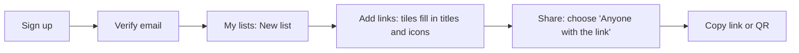
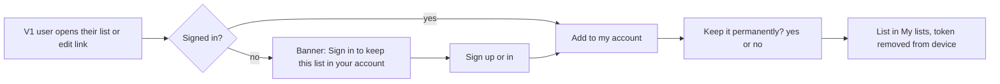
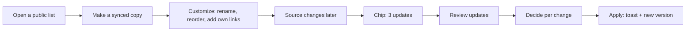

# 11: UI/UX migration

Goal: keep V1's calm, purple, one-obvious-next-step experience
([docs/design-system.md](../design-system.md)) while adding accounts, tiles, groups, history
and sync. **No enterprise dashboard.** Each new concept gets one clear screen, and the Git
vocabulary stays out of the UI.

## Product language

| Concept | UI words | Avoid |
|---|---|---|
| Branch | "Synced copy", "Make a synced copy" | branch |
| Fork | "Copy", "Make a copy" | fork |
| Parent | "Source list" | parent, upstream |
| Merge / sync | "Get updates", "Review updates" | merge, pull |
| ACCEPT / KEEP_LOCAL / EXCLUDE | "Use update" / "Keep mine" / "Ignore this link" | accept, local |
| Exclusion | "Ignored link", "Stop ignoring" | exclusion |
| Revision | "Version", "History", "Restore this version" | revision, snapshot |
| Visibility | "Only people you add" / "Anyone with the link" / "Public, listed in Explore" | private/unlisted (shown as secondary text) |
| Legacy list | "Saved on this device", "Add to my account" | token, legacy, claim |

## Screen inventory

| Route | V1 screen | V2 fate | Notes |
|---|---|---|---|
| `/` | Home: hero, create form, recent on device, how it works, FAQ | **Modified** | Signed out: landing page with Sign up / Sign in and a short explainer. Signed in: redirect to `/lists`. Create moves into My lists |
| `/lists` | Saved lists (device tokens, backup) | **Redesigned** as **My lists** | Tabs: Owned · Shared with me · On this device (legacy, with "Add to my account" and backup/restore until the sunset) |
| `/l/:code/:slug?` | List page (rows) | **Extended** | Tile grid (default) or list view toggle, add link, ⋮ tile menus, provenance banner, sync chip |
| `/l/:code/manage#t=` | Edit-link claim | **Kept** (legacy) | Saves the token to the device, then offers "Add to my account" if signed in |
| `/l/:code/history` | — | **New** | Version timeline, diff, restore |
| `/l/:code/sync` | — | **Postponed** ([ADR-015](adr/ADR-015-postpone-synchronization.md)) | Review updates (merge preview) |
| `/l/:code/settings` | — (owner menu) | **New** | Visibility, people, copy permissions, expiry, tags, image, delete |
| `/groups`, `/g/:code/:slug?`, `/g/:code/l/:listCode` | — | **New** | My groups; group workspace with a sidebar |
| `/explore` | — | **New** | Public directory: search, tags, sort |
| `/signin`, `/signup`, `/verify-email`, `/reset-password`, `/account` | — | **New** (task 1.2) | Kept minimal (prompt 8.8). Emailed links are `/verify-email#key=…` and `/reset-password#key=…`. The key travels in the fragment and is removed from the address bar on arrival |
| `/about` | About and privacy | **Modified** | New retention and privacy text; accounts explained |
| `/design` | Style guide (dev) | **Extended** | Tiles, diff cards, decision controls |
| 404 | Not found | Kept | |

## Navigation

App bar (desktop) and drawer (mobile), defined once in `navigation.ts` as in V1:
**My lists · Groups · Explore · About**, plus an account menu (display name → Account, Sign
out). Signed out, it shows **Explore · About · Sign in**. The "Saved lists" badge becomes a
badge on My lists while device-only lists exist.

## User journeys







Group journey: Groups → New group → Add lists (picker shows lists you own or edit, plus public
lists you search for) → reorder in the sidebar → share the group link.

## List page

```text
┌──────────────────────────────────────────────────────────────────────────┐
│ ‹ My lists                                                               │
│ Synced copy of Team tools · 3 updates  [Review]          (provenance)    │
│ Dev tools ✎                       [Share] [⋮ Settings·History·Copy…]     │
│ Anyone with the link · 12 links · Updated 2 h ago                        │
│ [Search links /]   [Custom order ▾]   [▦ Grid | ☰ List]   [+ Add link]   │
│ ┌────────┐ ┌────────┐ ┌────────┐ ┌────────┐                              │
│ │ [icon] │ │ [icon] │ │ [icon] │ │ [icon] │   tiles: 128×128 icon,       │
│ │ GitHub⋮│ │ Docker⋮│ │Postman⋮│ │ Redis ⋮│   name (2 lines), description│
│ │ Code…  │ │ Image… │ │ API…   │ │ Cache… │   (2 lines), ⋮ menu          │
│ └────────┘ └────────┘ └────────┘ └────────┘                              │
└──────────────────────────────────────────────────────────────────────────┘
```

- **Grid vs list:** grid (tiles) is the V2 default. V1's row layout stays as "List" view,
  which is denser and shows full descriptions. The choice is remembered per device
  (`useViewPreference`). That satisfies "switchable view" without dropping a working V1 layout.
- **Tile:** the icon area is 128×128 CSS px at ≥600 px viewports and 72 px on phones, using
  the uploaded icon, then the fetched icon, then `DomainAvatar`. Then the name (2-line clamp)
  and the description (2-line clamp; the full text is in the ⋮ menu's **Details** and in list
  view, so it stays available to every authorized viewer). The whole tile is the link, opened
  through the short URL as in V1. The ⋮ button is separate and keyboard-focusable.
- **⋮ menu:** Open · Copy short link · Details · (editors) Edit · Move up / down / to top /
  to bottom / to position… · Move to another list… · Delete.
- **Order:** "Custom order" (the stored order, the default), plus V1's client-side "Newest" and
  "A–Z" view sorts. Drag-and-drop and the Move items are active only in Custom order.
- **Add link:** a button opens the add form on mobile. Desktop keeps V1's inline card,
  collapsible. The fetched title, description and icon appear as suggestions after save;
  user-typed values always win.

## Groups workspace

```text
Desktop ≥1280                  Tablet 960–1279              Phone <960
┌────────────┬─────────────┐   ┌──┬────────────────────┐   ┌──────────────────────┐
│ Dev Portal │ Backend     │   │◧ │ Backend tools      │   │ ☰ Dev Portal ▾       │
│ ▸ Backend  │ tools       │   │B │ [tile][tile][tile] │   │ Backend tools        │
│   AI tools │ [tile]…     │   │A │                    │   │ [tile][tile]         │
│   Database │             │   │D │ rail expands on    │   │ ☰ opens a modal      │
│   Product… │             │   │P │ focus or click     │   │ drawer, Esc closes   │
└────────────┴─────────────┘   └──┴────────────────────┘   └──────────────────────┘
```

- `v-navigation-drawer`: **permanent** at ≥1280 px (280 px wide), **rail** with expand at
  960–1279 px, and **temporary** (modal, scrim, Escape closes, focus returns to ☰) below 960 px,
  which is V1's `AppNavDrawer` behaviour. **[Assumption]** Vuetify 4 keeps the `rail`,
  `permanent` and `temporary` props of the drawer used in V1. Verify in task 4.3 against the
  installed version, since the docs couldn't be fetched during planning.
- The sidebar is a `<nav aria-label="Lists in Dev Portal">` with links. The current list has
  `aria-current="page"`. Selecting a list navigates to `/g/{code}/l/{listCode}`, so the URL
  persists state and Back works. Focus moves to the list's `<h1>` (V1's route focus).
- The group header shows the group title, Share and ⋮ (Settings, Add list, Reorder). Lists the
  viewer can't see aren't rendered at all ([12](12-AUTHORIZATION.md#which-lists-a-group-shows-to-a-viewer)).
- Empty group: "Add your first list" with a list picker.

## Sharing

The Share dialog keeps V1's link, copy, QR and native share, and adds a **Who can see this**
selector at the top: "Only people you add" / "Anyone with the link" / "Public, listed in
Explore". Changing it asks for confirmation when widening, for example "Anyone with the link
will be able to see the 12 links." There is also a **People** section (owner: add by email,
role Editor or Viewer, remove). A private list's dialog explains that the link only works for
people on the list.

## Copy, synced copy and history

> **Postponed** ([ADR-015](adr/ADR-015-postpone-synchronization.md), 2026-10-29): V2 builds "Make a copy" only. The synced-copy card, the sync chip, the provenance banner's update count and **Stop syncing** are kept as the design.

- **⋮ → Make a copy…** opens `CopyListDialog` with two clear cards. "Copy: an independent
  list. Changes to *Team tools* won't reach it." "Synced copy: your own version that can get
  updates from *Team tools* when you choose. Your changes are never overwritten without your
  OK." Options the source doesn't allow are disabled with the reason.
- Provenance banner on synced copies: source title (if viewable), the sync chip
  (`Up to date`, `3 updates`, `Source deleted`, `Source unavailable`) and a **Review updates**
  button. ⋮ also has **Stop syncing** (detach), confirmed because it can't be undone.
- **History:** a timeline of versions (number, "Edited by Theo", "Updates from Team tools",
  "Restored version 7", relative time, change counts). Selecting a version shows its links and
  a diff against the previous one (added, removed and changed with field before/after). It has
  a **Restore this version** button, confirmed, showing "Creates version 15 with this content.
  Nothing is lost."

## Merge preview ("Get updates")

> **Postponed** ([ADR-015](adr/ADR-015-postpone-synchronization.md), 2026-10-29): this screen (`/l/:code/sync`) is not built in V2. Kept as the design.

```text
┌ Updates from Team tools ──────────────────────────────────────────────┐
│ Comparing Team tools v9 with your copy (last updated from v6)         │
│ 2 updates · 1 needs your choice · 1 ignored link changed              │
│                                                                       │
│ NEEDS YOUR CHOICE                                                     │
│ ┌ Docker ─────────────────────────────────────────────────────────┐   │
│ │ Title        Original: Docker   Source: Docker Hub   Yours: Docker Desktop │
│ │ ( ) Use update   (•) Keep mine   ( ) Ignore this link             │   │
│ └──────────────────────────────────────────────────────────────────┘   │
│ NEW IN SOURCE                                                         │
│ ┌ + Redis   redis.io ───────────────────────────────────────────────┐ │
│ │ (•) Add it   ( ) Not now   ( ) Ignore this link                    │ │
│ └────────────────────────────────────────────────────────────────────┘ │
│ ▸ Your own changes (1) · ▸ Ignored links (1) · Source order changed:  │
│   your order is kept                                                  │
│                                              [Cancel] [Apply 2 changes]│
└───────────────────────────────────────────────────────────────────────┘
```

- Sections in order: **Needs your choice** (conflicts, no default, apply disabled until each
  is chosen), **Updated in source**, **New in source**, **Removed from source** (defaults
  preselected and visible), then collapsed **Your own changes** and **Ignored links** (with
  "Stop ignoring"). The decision labels change per kind: for additions, "Add it" / "Not now" /
  "Ignore this link"; for removals, "Remove it" / "Keep it" / "Ignore this link".
- Field comparisons are a three-column table (**Original · Source · Yours**) with changed
  values highlighted by colour **and** a text marker ("changed"). URLs are shown with the host
  emphasized. Raw JSON is never shown.
- Blocked choices are disabled with a reason, for example "Your list already has this link".
  A link-cap warning appears if accepting everything would exceed 100.
- **Apply** shows a summary ("Add 1, update 0, keep 1 as yours"), sends the decisions with
  an idempotency key, and on success shows a toast "Your copy is up to date (version 15)" and
  returns to the list.
- **Stale preview** (409): an alert "The source list changed while you were reviewing" with
  **Review again**. Choices for unchanged items are pre-filled from the previous attempt
  (matched by source link and kind), so they aren't silently applied but also don't have to be
  redone. **Failure**: the error alert, and nothing was changed. Say so explicitly.

## Account screens

Sign in (email, password, "Forgot your password?"), Sign up (optional display name, email,
password with Django's validators shown inline), Verify email (opens the emailed link and
offers to resend it), Reset password (request, then choose a new one). Account: display name,
email with its verification status and a resend button, password change, sign out (task 1.2).
**Delete account** (type-to-confirm, lists owned → deleted, with a count) since task 1.7.
Changing the email address is a later enhancement. Sign-in and sign-up honour a validated
`?next=` path. No social login, no MFA in the MVP. allauth supports both later
([02](02-PRODUCT-REQUIREMENTS.md#accounts-and-access-51-56-88)).

## Responsive behaviour

| Width | Layout |
|---|---|
| < 600 px | 2-column tiles (72 px icons) or list view. Bottom sheet for ⋮ menus (Vuetify default). Add link opens a full-screen dialog. Group sidebar is a modal drawer |
| 600–959 px | 3–4 tile columns. Modal group drawer |
| 960–1279 px | 4–5 columns. Group sidebar as a rail |
| ≥ 1280 px | Content up to 1200 px for tile pages (V1's 880 px column stays for text pages). Permanent group sidebar |

## UI states

| State | Presentation (V1 component) | Copy (essence) |
|---|---|---|
| Loading | skeletons (V1) | — |
| Empty list | `StatePanel` | Editors: "Add your first link". Viewers: "Nothing here yet" |
| Empty group | `StatePanel` + Add list | "Add lists to build your workspace" |
| No search results | `StatePanel` + Clear search (V1) | "Nothing matches …" |
| Metadata in progress | tile shimmer on the icon area, `aria-busy` | "Fetching details…" (polite) |
| Metadata unavailable | `DomainAvatar` + subtle text in Details | "Couldn't fetch details for this site." Manual entry always works |
| Permission denied (signed in) | `StatePanel` | "You don't have access to this list" (403 only when the list is viewable) |
| Authentication required | `StatePanel` + Sign in | "Sign in to continue" |
| Not found / private | `StatePanel` (V1 not-found) | Identical for private and nonexistent (no leak) |
| Expired | `StatePanel` warning (V1) | "This list has expired" (no 30-day claim) |
| Deleted parent | banner on the child | "The source list was deleted. Your copy is unaffected." + Stop syncing |
| No updates | sync chip "Up to date" | — |
| Updates available | chip + banner button | "3 updates from Team tools" |
| Conflicts | "Needs your choice" section | — |
| Stale preview | alert + Review again | as above |
| Merge successful | toast + new version number | "Your copy is up to date" |
| Merge failed | error alert, decisions kept | "Nothing was changed. Try again." |
| Network failure | V1 offline banner + `NetworkError` | V1 copy |

Success is shown only after the server confirms. There are no optimistic success toasts for
merges, restores or claims.

## Accessibility (WCAG 2.2 AA)

- Everything is operable by keyboard: tiles, ⋮ menus, Move items, the sidebar, decision radio
  groups (`fieldset` + `legend` naming the link), and the dialogs (V1 focus trap and return).
- Every drag has a single-pointer, non-drag alternative (the ⋮ Move items) (SC 2.5.7 [R21]).
  Reorders are announced in a polite live region.
- Visible focus uses the V1 `focus` role. The contrast script is extended to tile, diff and
  chip colours. Diff states never rely on colour alone.
- Screen-reader labels: tile links read "GitHub, opens in a new tab". ⋮ buttons read "More
  actions for GitHub". Decision groups read "Docker: title changed in both lists".
- Errors are announced (V1 pattern). Validation focuses the first invalid field or the first
  undecided conflict.
- Reduced motion turns off tile and drag animations (V1 rule).
- The manual QA checklist ([docs/qa-checklist.md](../qa-checklist.md)) gains the merge preview,
  drag alternatives and the sidebar on VoiceOver and NVDA (task 9.3).

## Copy that changes

The "Gone after 30 days", "Free, no sign-up. Lists expire after 30 days", footer and About
page texts, and the expired-state wording, are rewritten for permanent lists with optional
expiry and for accounts (task 1.4). The About page explains what is stored now (an account
email, owned lists, history) and how to delete it.
