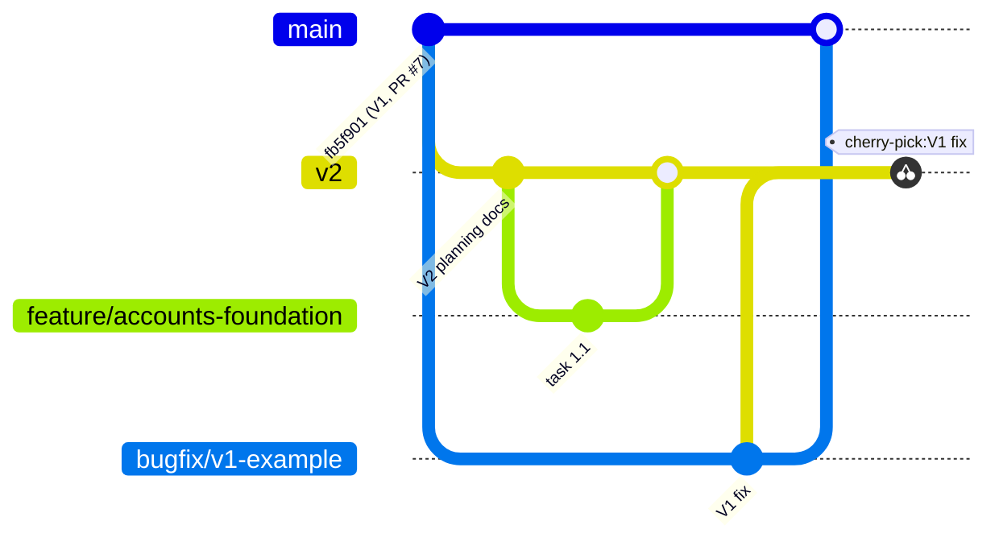

# 16: Git workflow

Version 1 and Version 2 coexist in one GitHub repository (`flokos/listlinkedin`, public). Two
long-lived branches carry them ([ADR-009](adr/ADR-009-git-v2-integration-branch.md)):



| Branch | Holds | Who writes |
|---|---|---|
| `main` | Version 1, production, default branch (unchanged) | PRs from `bugfix/v1-*` only, and the final V2 release PR |
| `v2` | Version 2 integration, created from `main` at `fb5f901` | PRs from V2 branches only |
| `feature/*`, `fix/*`, `docs/*`, `chore/*` | one roadmap task each, branched from `v2` | developers and Claude Code sessions |
| `bugfix/v1-*` | one V1 fix, branched from `main` | |
| `release/v1` (at the V2 release) | the last V1 state, for rollback and emergency fixes | |

The default branch stays `main` (prompt 2.3), and nothing in this workflow changes it.

## Daily V2 work

```bash
git fetch origin
git switch -c feature/<area>-<topic> origin/v2          # always from the current v2
git config branch.feature/<area>-<topic>.gh-merge-base v2   # optional: makes v2 the gh default base
# … commits …
git push -u origin HEAD
gh pr create --base v2 --fill                            # --base v2 is mandatory
```

- `gh pr create` without `--base` targets the repository default (`main`). `gh` 2.102 reads
  `branch.<name>.gh-merge-base` when no `--base` is given [R29]. Set it, or always pass
  `--base v2`.
- In VS Code, the GitHub Pull Requests extension proposes the base recorded in
  `branch.<name>.vscode-merge-base`, which it sets when a branch is created from another
  branch (observed in this repository's git config). Check the base field before creating.
- Keep PRs to one roadmap task ([17](17-IMPLEMENTATION-ROADMAP.md)). Rebase *your feature
  branch* on `origin/v2` when needed. Never rebase `v2` or `main`.
- Merge method into `v2`: **squash and merge**, which gives one commit per task and a clean
  revert unit. The subject is imperative, like the existing history ("Add …", "Fix …").

## Preventing PRs into `main`

Mechanisms evaluated (prompt 2.3):

| Mechanism | Used? | Notes |
|---|---|---|
| **CI target guard** | ✓ on `v2` | The first step of the `checks` job in `v2`'s `ci.yml` fails a PR whose base is `main`, unless the head is `v2` from this repository (the release PR). GitHub runs a `pull_request` workflow from the PR's merge commit, which contains `v2`'s workflow file [R25], so the guard only fires for branches built on `v2`. V1 PRs from `main` use `main`'s workflow and are unaffected. PRs with merge conflicts don't run workflows at all [R25] and are blocked by the required check anyway |
| **Repository rulesets** | ✓ `main` and `v2` | [Below](#rulesets). `main` requires the `checks` status, which makes the guard **blocking**, not just a red cross. Rulesets are available for public repositories on GitHub Free [R27] |
| Branch protection rules (classic) | — | Rulesets supersede them and layer better [R27]. Don't use both |
| PR template | — (documented) | GitHub only loads templates from the **default branch** [R28], so a template on `v2` would never appear. Adding one to `main` is a V1 change. The proposed text is [below](#optional-pr-template-for-main), for a separate V1 docs PR if wanted |
| CODEOWNERS | — | A single-maintainer repository. Add one if collaborators join, together with "require code owner review" |
| Branch naming convention | ✓ | `feature/`, `fix/`, `docs/`, `chore/` for V2; `bugfix/v1-` for V1 |
| Local git hook | optional | The server-side rulesets already block direct pushes. A `pre-push` hook that refuses `main` is a personal convenience ([below](#optional-local-hook)) |
| CLAUDE.md | ✓ | Every Claude Code session on `v2` reads the rules first |

The guard step, as committed in `.github/workflows/ci.yml` on `v2`:

```yaml
      - name: V2 pull requests must target v2
        if: github.event_name == 'pull_request'
        env:
          BASE_REF: ${{ github.base_ref }}
          HEAD_REF: ${{ github.head_ref }}
          HEAD_REPO: ${{ github.event.pull_request.head.repo.full_name }}
          REPO: ${{ github.repository }}
        run: |
          if [ "$BASE_REF" = "main" ] && { [ "$HEAD_REF" != "v2" ] || [ "$HEAD_REPO" != "$REPO" ]; }; then
            echo "::error title=Wrong base branch::This pull request contains Version 2 work but targets main. Change its base branch to v2. Only the release PR from v2 may target main. See docs/v2/16-GIT-WORKFLOW.md."
            exit 1
          fi
```

Branch names are passed through `env`, never interpolated into the script, so a hostile branch
name can't inject shell code. `ci.yml` on `v2` also runs on pushes to `v2`, so every merged
task is tested on the integration branch.

## Rulesets

Created with the GitHub REST API [R26] (`POST /repos/flokos/listlinkedin/rulesets`) by
roadmap task 0.3, right after `v2` is first pushed:

```json
{
  "name": "main (Version 1)",
  "target": "branch",
  "enforcement": "active",
  "conditions": {"ref_name": {"include": ["refs/heads/main"], "exclude": []}},
  "bypass_actors": [{"actor_id": 5, "actor_type": "RepositoryRole", "bypass_mode": "pull_request"}],
  "rules": [
    {"type": "deletion"},
    {"type": "non_fast_forward"},
    {"type": "pull_request", "parameters": {
      "required_approving_review_count": 0, "dismiss_stale_reviews_on_push": false,
      "require_code_owner_review": false, "require_last_push_approval": false,
      "required_review_thread_resolution": false}},
    {"type": "required_status_checks", "parameters": {
      "strict_required_status_checks_policy": false,
      "required_status_checks": [{"context": "checks", "integration_id": 15368}]}}
  ]
}
```

The `v2` ruleset is identical, with `"name": "v2 (Version 2 integration)"` and
`"include": ["refs/heads/v2"]`.

- Effect: no deletion, no force-push, no direct pushes. Changes arrive only through PRs whose
  `checks` job passed. Zero required approvals, because a solo maintainer can't approve their
  own PRs.
- Bypass: the repository **Admin** role (`actor_id` 5) in `pull_request` mode. An admin can
  merge a PR whose checks failed (an explicit "bypass" checkbox) but still can't push
  directly. Admins can always edit or disable rulesets, so nobody gets locked out.
- `integration_id` 15368 is GitHub Actions, so only Actions can satisfy the `checks` context.

**Verify what is actually enforced.** Never assume:

```bash
gh api repos/flokos/listlinkedin/rulesets --jq '.[] | {id, name, enforcement}'
gh api repos/flokos/listlinkedin/rules/branches/main --jq '.[].type'
gh api repos/flokos/listlinkedin/rules/branches/v2 --jq '.[].type'
```

Manual equivalent: *Settings → Rules → Rulesets → New branch ruleset*, with the same target,
rules and bypass as above.

### Enforcement status

Verified on 2026-10-28, right after `v2` was first pushed (`95cb878`). This records one point
in time. Re-run the commands above whenever in doubt.

| Ruleset | Id | Target | Rules returned by `GET /rules/branches/{branch}` |
|---|---|---|---|
| main (Version 1) | 26061515 | `refs/heads/main` | `deletion`, `non_fast_forward`, `pull_request` (0 approvals), `required_status_checks` (`checks`, integration 15368) |
| v2 (Version 2 integration) | 26061516 | `refs/heads/v2` | the same four |

- GraphQL `bypassActors` reports `repositoryRoleName: admin` with `bypassMode: PULL_REQUEST`,
  which confirms that `actor_id` 5 is the Admin role.
- `GET /apps/github-actions` returns id 15368, so only GitHub Actions can satisfy the
  required `checks` context.
- The default branch is still `main`. Other branches (`test/e2e`) have no rules.
- The push to `v2` ran CI (run 40736258527): `checks`, `proxy` and `e2e` passed. The guard step
  was skipped, as intended, because it runs only on pull requests.

## V1 fixes and porting to V2

1. Fix on `main`: `git switch -c bugfix/v1-<topic> origin/main` → PR into `main` → merge.
2. Decide whether V2 needs it. Usually yes for security fixes. Not when the code was
   rewritten in V2. In that case, port the *test* and fix the V2 code to pass it.
3. Port: `git switch -c fix/port-<topic> origin/v2 && git cherry-pick -x <sha>` → PR into `v2`.
   `-x` records "(cherry picked from commit …)" in the message, so ported fixes are findable.
4. Weekly, and before the release, list `main` commits not yet ported:

```bash
git log --oneline --no-merges origin/v2..origin/main   # every main commit not in v2…
git log origin/v2 --grep 'cherry picked from commit' --format='%b' | grep -o '[0-9a-f]\{40\}'   # …minus these
```

`main` is **never merged wholesale** into `v2` during development (prompt 2.4). The one
exception is the reviewed reconciliation PR just before the release.

## Releasing V2

1. Reconciliation: a PR `chore/reconcile-main → v2` that merges `origin/main` into a branch
   from `v2`. Every fix is already ported, so conflicts are trivial. Review it like any PR.
2. On `main`: tag `v1.0.0` and create `release/v1` from it. V1 stays buildable for rollback
   ([06](06-MIGRATION-PLAN.md#rollback)).
3. Release PR `v2 → main`, using a **merge commit** (not squash) to keep V2 history. The guard
   allows it (head `v2`, same repo).
4. Tag `v2.0.0` on `main` and deploy (06 deployment strategy).
5. Afterwards: change the `v2` ruleset's enforcement to `disabled`, and stop merging into
   `v2`. New work branches from `main` again. Deleting `v2` later is the maintainer's decision
   (it is not part of any plan here).

## CI checks

| Job | Runs on | V2 additions |
|---|---|---|
| `checks` | every PR; pushes to `main` and `v2` | target guard (first step); the dependency vulnerability audit (`pip-audit`, `npm audit`, since task 9.1) |
| `proxy` | same | V2 smoke additions (media headers, `/_allauth/` routing) |
| `e2e` | same | new journeys ([15](15-TEST-STRATEGY.md#end-to-end-scenarios)) |

## Optional: PR template for `main`

If a `.github/pull_request_template.md` is added to `main` in a separate V1 docs PR, it shows
up for every PR in the repository:

```markdown
## Target branch
- [ ] Version 2 work → base branch is **v2** (see docs/v2/16-GIT-WORKFLOW.md on the v2 branch)
- [ ] Version 1 fix → base branch is **main**; port to v2 with `git cherry-pick -x` afterwards
## What and why
## How it was tested
```

## Optional: local hook

```bash
# .git/hooks/pre-push: refuse direct pushes to main and v2 (the server enforces this anyway)
while read -r _ _ remote_ref _; do
  case "$remote_ref" in refs/heads/main|refs/heads/v2) echo "Push a branch and open a PR instead." >&2; exit 1;; esac
done
```
