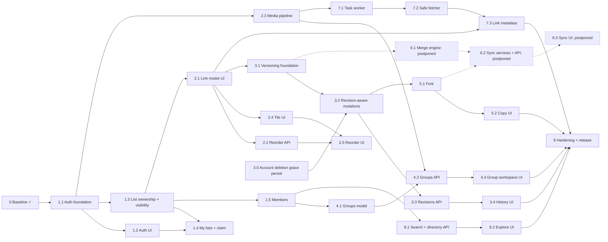

# 17: Implementation roadmap

How to use this document:

- **One task = one branch from `v2` = one PR into `v2`.** The branch name is given per task.
  Tick the task's box in the PR that completes it.
- Every task names the specs to read first. Every PR meets the definition of done in
  [CLAUDE.md](../../CLAUDE.md#definition-of-done-for-every-v2-pr).
- Sizes are rough: **S** ≤ 1 day, **M** 2–3 days, **L** 4–5 days. A task that grows beyond L
  is split before it is started.
- Phases are coherent, testable increments of the `v2` codebase (staging), not production
  releases. Production moves from V1 to V2 once, in phase 9 ([06](06-MIGRATION-PLAN.md)).
- The order follows technical dependencies. It is not a waterfall: the lanes below run in
  parallel wherever the dependency graph allows.
- **Synchronization is postponed** ([ADR-015](adr/ADR-015-postpone-synchronization.md),
  2026-10-29): phase 6 and synced copies (branches) are not part of the V2 release. Phase 6
  keeps its task numbers so the design stays traceable. Dashed nodes in the graph are postponed.

## Dependency graph and parallel lanes

| Lane | Can run in parallel with | Notes |
|---|---|---|
| A: accounts and ownership (1.x) | 1.6 dependency refresh, 2.3 media | 1.1 first, since everything with a user FK depends on it |
| B: links and tiles (2.x) | 1.4, 1.5 | 2.1 is the gate for revisions and metadata |
| C: revisions → fork (3, 5) | 4.x, 7.x, 8.x | Sync (6.x) is postponed ([ADR-015](adr/ADR-015-postpone-synchronization.md)) |
| D: groups (4.x) | 3.x, 5.x | needs 1.5 (roles) and 2.3 (images) |
| E: metadata (7.x) | 3.x–5.x | needs 2.1 and 2.3 |
| F: discovery (8.x) | 3.x–5.x, 7.x | needs 1.3 and 1.5 (visibility, verified-email gate) |

**Recommended first implementation PR: task 1.1 (`feature/accounts-foundation`).** The custom
user model must exist before the first migration that references users, and nearly every
other task depends on it. It is backend-only and leaves the V1 UI and API working unchanged
(DRF views are CSRF-exempt unless `SessionAuthentication` applies, and V1 uses bearer tokens).

---

## Phase 0: Repository and baseline

**Goal:** a safe `v2` branch, a verified V1 baseline, and complete planning documentation.
**Status:** complete (2026-10-28).

- [x] **0.1** Create `v2` from `main` at `fb5f901`. Inspect Git state ([01](01-V1-AUDIT.md#repository-and-git)).
- [x] **0.2** V1 audit, test baseline (129 backend tests, frontend checks green), `docs/v2/`, `CLAUDE.md`, ADRs.
- [x] **0.3** Push `v2` (`95cb878`); CI guard in `ci.yml` (target check + `v2` push trigger); rulesets on `main` and `v2`. Verified 2026-10-28: rulesets 26061515 (`main`) and 26061516 (`v2`) are enforced, and CI run 40736258527 on `v2` passed `checks`, `proxy` and `e2e` ([16](16-GIT-WORKFLOW.md#enforcement-status)).

---

## Phase 1: Accounts, ownership and visibility

**Goal:** users can sign up and sign in, create lists that they own, and choose who sees each
list. V1 lists keep working through their edit links and can be claimed.
**Dependencies:** phase 0. **Read:** [ADR-007](adr/ADR-007-authentication-and-ownership-migration.md),
[ADR-011](adr/ADR-011-accounts-required-legacy-lists.md), [12](12-AUTHORIZATION.md),
[06](06-MIGRATION-PLAN.md#ownership-transition), [09](09-API-DESIGN.md).

| Area | Work |
|---|---|
| Backend | `accounts` app, allauth headless, sessions, CSRF, `/api/v2/` skeleton with the exception handler, `sharing/policy.py`, `ListViewSet`, legacy bearer principal, claim, memberships |
| Frontend | split API client (CSRF, session), `useSession`, auth screens, My lists (owned, shared, on this device), claim, Share dialog with visibility and people, copy rewrite |
| Database | `accounts_user` + contrib tables + allauth; list ownership, visibility, description, slug, `allow_*`, tags, `creation_key`; `ListMembership`; CHECKs L2 and L3 |
| Infrastructure | email settings (console in dev); Mailpit in the dev and e2e stacks; nginx and Vite route `/_allauth/`; `DB_STATEMENT_TIMEOUT` override for `migrate` |
| Tests | auth flows, CSRF, the permission matrix (lists), leak tests, migration test on V1-shaped data, v1 create → 410, e2e: signed-in create, legacy claim |

| Task | Branch | Scope | Depends on | Size |
|---|---|---|---|---|
| [x] **1.1** Auth foundation | `feature/accounts-foundation` | contrib auth, contenttypes, sessions; `CsrfViewMiddleware`; `accounts.User` in `0001_initial` + `AUTH_USER_MODEL`; allauth headless (browser, email login, email verification optional, enumeration prevention); session and CSRF cookie settings; remove the W003 silence; `GET /api/v2/session/`, `PATCH /api/v2/me/`; v2 URL namespace + domain-error exception handler; `migrate` statement-timeout override | 0 | M |
| [x] **1.2** Auth UI | `feature/auth-ui` | `api/client.ts` split (CSRF, `same-origin` credentials, `code` on `ApiError`), `useSession`, routes and guards (`next` validation), sign in/up, verify, reset, account (no deletion yet), nav and account menu; Mailpit; e2e auth flows | 1.1 | M |
| [x] **1.3** List ownership and visibility | `feature/list-ownership` | list fields + migration (V1 rows → unlisted legacy lists, slugs backfilled) + CHECKs L2/L3; `ListMembership` model; pure `policy.py` (+ visibility filtering in selectors); `ListViewSet` (list, create, retrieve, update, destroy, rotate-token) with `Idempotency-Key`; legacy bearer on v2; V1 reads and `/r/` respect visibility; verified email required for `public`; slug (`/l/{code}/{slug}`). **V1 create retirement moved to 1.4**, so the create form and the V1 e2e suite keep working until the signed-in create UI lands | 1.1 | L |
| [x] **1.4** My lists and claim | `feature/my-lists-claim` | `POST …/claim/`; **v1 create → 410** (moved from 1.3), behind `LEGACY_LIST_CREATION` (default `off`; tests and e2e turn it on to seed legacy lists; removed in 9.6); **session-authenticated `LinkViewSet` (list, create, update, delete) pulled forward from 2.1**, because account lists have no token for the v1 link endpoints; My lists ("Your lists" and "On this device"); "Add to my account" (single and bulk); signed-in create; signed-out landing; "Keep permanently?" prompt; Share dialog visibility selector; rewrite of the 30-day copy; e2e: replace `create.spec`, add the legacy-claim journey | 1.2, 1.3 | L |
| [x] **1.5** Members | `feature/list-members` | members API (add by email, roles, remove, leave), `permissions` in representations (new `view_members`), People section in the Share dialog, "Leave list", full list matrix tests over HTTP, a revoke-during-write concurrency test. Only **verified** addresses can be added, with one generic answer otherwise ([13](13-SECURITY.md#residual-risks-accepted)). Also: anonymous refusals now answer 401 as [12](12-AUTHORIZATION.md#status-codes) says (they were 403 since 1.3), and tests hash passwords with MD5 (suite 165 s → 31 s) | 1.3 | M |
| [x] **1.6** Dependency refresh | `chore/drf-3-18` | DRF 3.16 → 3.18 and other minor updates after reading the release notes; all V1 tests green. Done 2026-10-29: DRF 3.16.1 → **3.18.3** (pin `>=3.18.3,<3.19`), pytest 9.1.1 → 9.2.0. Release notes 3.17.0–3.18.3 checked: the breaking items (coreapi removed, `many=True` error format, Django < 5.2 dropped) don't touch this code. Everything else is current; Django stays on 5.2 LTS. Left out on purpose (majors): TypeScript 6 → 7, `@types/node` 24 → 26 (matches the Node 24 runtime) | 0 | S |
| [x] **1.7** Account deletion | `feature/account-deletion` | (Changed by 3.0, [ADR-016](adr/ADR-016-account-deletion-grace-period.md): deletion now has a 30-day grace period.) `DELETE /api/v2/me/` (owned lists and groups deleted first, type-to-confirm), UI. Done: `accounts.delete_account` calls the `sharing` service `delete_lists_owned_by` (locks the rows in id order), then deletes the user in the same transaction; a list claimed or created mid-deletion → 409, nothing deleted. The session is flushed; other sessions stop resolving. `?role=` filter on `GET /api/v2/lists/` for the dialog's count. Groups join this flow in 4.1 | 1.4 | S |
| [x] **1.8** E2E flake: link edit on WebKit | `fix/e2e-link-edit-flake` | **Symptom:** `links.spec` "edits a link … and deletes after confirming" needed a retry in 5 of 12 CI runs up to 2026-10-29 08:10 (PRs #10, #12, #14 and a `v2` push), always on WebKit engines, always at `expect(getByText('Link updated'))` with "element(s) not found" for the full 10 s. **Corrected:** the earlier note ("the toast was gone before the check") came from an overloaded local run and doesn't fit CI: the check polls right after the click, so the toast never appeared. **Ruled out:** the pointer resting on the earlier "Editing unlocked" toast (Vuetify pauses a snackbar's timer on hover; a probe measured the pointer far from it). **Not reproduced:** 52 local runs on WebKit and mobile Safari; 0 in 7 CI runs since PR #15 (which changed how specs share CI workers), including 5 dedicated reruns. **Done:** CI now uploads the report and traces whenever a test failed, including flaky tests that passed on retry. **Proof it works:** this PR's own CI caught a *different* flake with a trace. In `auth.spec` (password reset), the test typed into "Email" before the reset page had loaded, so the address went into the sign-in page's field and the reset form submitted empty. Fixed by waiting for the reset page's heading first. **If the link-edit flake recurs:** download the `e2e-report` artifact of that run, read the trace, and fix the cause. Don't lengthen timeouts | 0 | S |

**Acceptance criteria:** a new user can sign up, verify, create a private list and share it as
unlisted. Anonymous users can't create lists. A V1 edit link still edits its list and can be
claimed exactly once. Private lists return 404 everywhere for outsiders. Every V1 regression
test is green or replaced as listed in [15](15-TEST-STRATEGY.md#v1-regression-checklist).
**Risks:** auth misconfiguration (CSRF or cookies) → covered by API tests and deploy checks.
The legacy principal leaking onto claimed lists → explicit tests.
**Definition of done:** all of the above, plus the policy matrix test for lists, the v1 API
compatibility tests, and the e2e suite in all five projects.

---

## Phase 2: Links as tiles

**Goal:** links get identity-preserving soft deletion, a stored order, descriptions and icons,
and the list page shows tiles with accessible reordering.
**Dependencies:** 1.3. **Read:** [04](04-DOMAIN-MODEL.md#link-sharingsharedlink),
[05](05-DATABASE-DESIGN.md#sharing_sharedlink-existing-extended), [ADR-005](adr/ADR-005-child-ordering-policy.md),
[ADR-012](adr/ADR-012-media-and-images.md), [ADR-013](adr/ADR-013-soft-delete-links-only.md), [11](11-UI-UX-MIGRATION.md#list-page).

| Task | Branch | Scope | Depends on | Size |
|---|---|---|---|---|
| [x] **2.1** Link model v2 | `feature/link-model-v2` | link columns, position backfill (newest-first → 0..n-1), swap to the partial unique index, deferrable position unique, tombstone CHECK, live-source unique index; services: append, tombstone with compaction, `creation_key`; extend the `LinkViewSet` from 1.4 (positions, tombstones); v1 endpoints mapped onto the same services (v1 ordering kept); tombstoned short URL → 404. Done: migrations `sharing.0003`–`0005` (backfill batched per 500 lists, tested on V1-shaped data); one set of `*_on` link operations used by v1 and v2; insert at `position` (clamped); live-only counts and the 100-link cap; a concurrency test (parallel adds and deletes keep positions dense). The UI keeps "Newest" as an explicit sort by creation time; showing the stored order comes with 2.4/2.5. `icon` and `metadata` columns exist but stay unused until 2.3 and 7.3 | 1.3 | L |
| [x] **2.2** Reorder API | `feature/link-reorder` | `POST …/reorder/` (move), `move-to-list` (two locks in id order), concurrency tests. Done: moves shift only the links between the old and new place (deferred position constraint); `move-to-list` copies title, description and fetched metadata, needs edit rights on both lists, and answers 404 for a target the caller can't see; PostgreSQL concurrency tests for parallel moves (dense positions, nothing lost) and opposite cross-list moves (no deadlock). The client functions come with the reorder UI (2.5) | 2.1 | M |
| [x] **2.3** Media pipeline | `feature/media-pipeline` | Pillow, `MEDIA_*`, `media` volume, nginx `/media/` headers, per-route upload limits (Django + nginx), list image and link icon endpoints, `cleanup_media`, image security tests, smoke-test additions. Done: Pillow 13.0; the pipeline in `apps/metadata/images.py` (content sniffing, 16 MP limit with the bomb warning as an error, `verify` and reload, EXIF orientation, shrink-only fit into 128 or 512 px, WebP re-encode, content-addressed storage with atomic writes); `sharing.0006_list_image`; `PUT`/`DELETE` `…/image/` and `…/links/{id}/icon/` (multipart, `upload` rate limit 120/h, the policy's new `upload` action: editors and owners, never an edit link; checked before decoding and again under the lock); `image_url` on lists and `icon_url` on v2 links; Django and nginx allow larger bodies on those two routes only; nginx serves `/media/` (WebP type only, `nosniff`, sandbox CSP, immutable caching except for 404s); `cleanup_media` weekly; 12 smoke checks. No UI yet: the icon field in `LinkForm` comes with 2.4 and the list image with the settings page | 1.1 | M |
| [x] **2.4** Tile UI | `feature/tile-ui` | `LinkTile`, `LinkGrid`, `ViewToggle`, split `ListView.vue`, `LinkForm` description and icon, Details, `display` precedence. Done: `display` on v2 links (user > fetched > host fallback, computed by the server); `LinkTile`/`LinkGrid` (128 px icons, 72 px on phones, stretched link, separate ⋮), `LinkCard` as the list view with full descriptions, `ViewToggle` remembered per device (`useViewPreference`), sort menu (Custom order default, Newest, A–Z), `LinkMenu` (Open, Copy short link, Details; Edit and Delete for editors), `LinkDetailsDialog`, `LinkEditDialog` with the icon upload (`ImageUploadField`, accounts only), description in `LinkForm`; `ListView.vue` split into `ListHeader`, `ListToolbar`, `AddLinkCard`, `LinkCollection`. **Pitfall (recorded before the rework; still present, now fixed):** the edit dialog's Link field (`LinkForm`, `:autofocus` in edit mode) gets focus late, after the dialog's opening transition, and steals it from a field the user (or a test) already moved to. Seen in PR #20's CI trace: `links.spec` filled Title ~30 ms after Link, focus jumped back, "New title" was typed into the URL (`https://example.com/newNew title`), the save failed with 400 and "Link updated" never appeared. This is the 1.8 flake's cause. Vuetify's `autofocus` focuses from an IntersectionObserver callback, unconditionally. Fixed: no `autofocus`; `LinkEditDialog` focuses the URL on `after-enter` only if focus isn't already in the form, and `links.spec` waits for that focus before filling. Checked in a browser: filling Title right after opening keeps focus and text there. Left for 2.5: the mobile Add link button | 2.1 | L |
| [x] **2.5** Reorder UI | `feature/reorder-ui` | one-day spike (vue-draggable-plus on the phone projects), drag reorder, ⋮ Move items, live region, e2e scenario 4; the mobile **Add link** button and collapsible desktop add card left over from 2.4 ([11](11-UI-UX-MIGRATION.md#list-page)). Done: the spike kept vue-draggable-plus 0.6.1 (mouse drag in Chromium, Firefox and WebKit; long-press touch drag on mobile-chrome; iOS touch drag can't be automated, so it joins the 9.3 manual pass; [10](10-FRONTEND-ARCHITECTURE.md#drag-and-drop)); moves show at once and are replaced by the server's order (only the latest answer applies); ⋮ Move up, down, to top, to bottom, to position…, and Move to another list…; moves only in Custom order without a search; `LiveRegion` announcements; collapsible add card (closed on phones once the list has links); `reorder.spec` (scenario 4) | 2.2, 2.4 | M |

**Acceptance:** the order persists and is identical for all viewers. Moves under concurrency
never lose updates. Deleting a link keeps its row (tombstone), and its short URL answers 404.
Reordering is fully possible without dragging. **Risks:** mobile drag-and-drop breakage (the
spike, plus the Move menu as a guaranteed path). The constraint swap migration (tested on
V1-shaped data).

---

## Phase 3: Revision history

**Goal:** every content change is versioned atomically, and users can browse and restore
versions. **Dependencies:** 2.1. **Read:** [07](07-REVISION-SPEC.md), [ADR-003](adr/ADR-003-immutable-revision-snapshots.md).

| Task | Branch | Scope | Depends on | Size |
|---|---|---|---|---|
| [x] **3.0** Account deletion grace period | `feature/account-deletion-grace` | Added on the user's decision (2026-10-29, [ADR-016](adr/ADR-016-account-deletion-grace-period.md)), so revisions keep their authors without deleting user rows. Done: `User.deleted_at` and `sessions_revoked_at` (in the session hash: deleting signs out every device, restoring doesn't revive old sessions); `DELETE /api/v2/me/` schedules; `POST /api/v2/me/restore/`; a deleting account is signed out everywhere except the session check and restore; its owned lists are hidden (`OWNER_ACTIVE` in every list read and lock, short URLs 404) and it leaves member lists and add-by-email; `purge_deleted_accounts` daily 03:40 deletes owned lists and memberships and anonymizes the row (`is_active = false`); UI: dialog copy, `/account/restore` with the redirect guard; e2e delete → sign in → restore in all five projects; `versioning.0004` makes the revision trigger strict again (no `created_by_id` exception) | 1.7 | M |
| [x] **3.1** Versioning foundation | `feature/versioning-foundation` | `versioning` app; `ListRevision`; immutability trigger; `versioning/domain/snapshot.py` (schema v1, builder, validator, upcaster hook); `head_revision`; baseline `migrated` revisions (batched data migration); the domain-import AST test. Done: `versioning` app; `ListRevision` (unique (list, number), CHECKs on number and kind, `save()` refuses updates); `sharing.0007_head_revision`; the trigger (lets only `created_by_id → NULL` through, so deleting an author's account still works); `versioning/domain/snapshot.py` and `diff.py` (summary counts, moves counted by longest kept run); `record_revision` (no-op detection, head under the caller's lock; not yet called by mutations, that is 3.2); `versioning.0003_baseline_revisions` (SQL per 500 lists, checked equal to the Python builder, reversible); tests including 20 concurrent writers (consecutive numbers, head = live, R4) and the AST import rule over `versioning/domain`, `sharing/policy.py` and `common/errors.py` | 2.1 | M |
| [x] **3.2** Revision-aware mutations | `feature/revision-aware-mutations` | `record_revision` inside every content mutation (including legacy writes and moves), no-op detection, `ETag`/`If-Match`, R1–R4 tests including concurrency and forced-failure tests. Done: `record_revision` in every content write (v2 lists and links, the V1 edit-link path without an author, move-to-list in both lists, link icons; not settings, the list image, claims or metadata); list creation is one transaction with revision 1; optional `If-Match` checked under the lock (412 with the current `head_revision`; strong comparison; list settings exempt); `ETag` on detail, links and write responses; `head_revision` in the list representation; `versioning.0005` baselines for lists created between 3.1 and 3.2; tests: one revision per operation and none for no-ops, a forced failure rolls back link and revision, 20 concurrent writers get 2..21, R4 over seeded random sequences (no Hypothesis dependency). The UI starts sending If-Match in 3.4 | 3.1 | L |
| [x] **3.3** Revisions API | `feature/revisions-api` | list, detail with diff, restore (revive, tombstone, reposition) with the required `If-Match`. Done: `GET …/revisions/` (paginated, newest first, authors incl. "edit link", "Deleted account" and null for baselines; editors, owners and the edit link only) and `…/revisions/{n}/` (upcast snapshot and `diff_from_previous` from `versioning/domain/diff.compare`); `POST …/restore/` (428 without If-Match, 412 when stale; tombstone, park changing URLs, revive and reorder, restore title and description, record `restored` with `restored_from`; no-op when equal to the head; settings untouched; `restore` rate limit); tests for authors, permissions, diffs, revival with the same ids and short URLs, URL swaps and reuse, preconditions and the edit link | 3.2 | M |
| [x] **3.4** History UI | `feature/history-ui` | `/l/:code/history`, timeline, diff, restore confirm, e2e scenario 6; the edit forms send `If-Match` and handle 412 (reload, keep the user's input). Done: `HistoryView` (`/l/:code/history?v=N`, ⋮ History), `HistoryTimeline` (an `<ol>` of links; Vuetify's list role failed axe), `RevisionDiff`, restore confirm with the precondition (412 reloads history), wording in `utils/history.ts`; the client's `ifMatch`/`onEtag` options, `useListPage` sends If-Match on content writes and reloads on 412 (the form keeps its input); e2e `history.spec` (scenario 6), a mocked 412 in `states.spec`, axe on history | 3.3 | M |

**Acceptance:** the R1–R5 invariant tests pass, including 20 concurrent writers. A restore
revives links with the same short URLs. **Risks:** revisions diverging from the live state
(R4 property test). Snapshot size (measured. The cap keeps it small).

---

## Phase 4: Groups

**Goal:** workspaces of lists with a responsive sidebar, which never leak hidden lists.
**Dependencies:** 1.5, 2.3. **Read:** [12](12-AUTHORIZATION.md#which-lists-a-group-shows-to-a-viewer), [11](11-UI-UX-MIGRATION.md#groups-workspace).

| Task | Branch | Scope | Depends on | Size |
|---|---|---|---|---|
| [x] **4.1** Groups model | `feature/groups-model` | `Group`, `GroupList`, `GroupMembership`, constraints, group code generation (V1 helper), policy extension (group roles, display rule in SQL), services with locks. Done: `groups` app and `groups.0001` (unique code, visibility CHECK, unique (group, list), deferrable unique (group, position), position ≥ 0, index on the list; `tags` waits for 8.1, as on lists); `GroupAction`, `GroupFacts`, `can_group`, `can_add_list`, `shown_in_group` in `sharing/policy.py`; `groups/selectors.py` (`get_group_for`, `groups_of` with per-viewer `list_count`, `entries_for`, `shown_lists_q`, `members_of`); `groups/services.py` (create with `create_with_unique_code`, update, delete, add list locking group and list in id order, remove, move keeping hidden entries in place, members, at most 100 lists); account deletion hides a deleting owner's groups and erasure deletes them and the account's group memberships; tests: the pure matrix, SQL vs policy for every viewer × list visibility × group visibility, leak cases, real-lock concurrency (cap, removal mid-add, list made private mid-add) | 1.5 | M |
| [x] **4.2** Groups API | `feature/groups-api` | `GroupViewSet` + lists, reorder, members, image; leak tests (public group × private, unlisted and public lists × viewer types). Done: `groups/views.py` and `urls.py` (session only): groups CRUD with `?role`, `…/lists/` (a plain array of list summaries with `shown_to_all`, never stored positions), add (409 `duplicate_list`, 403 `cannot_share_list`), remove, `reorder` (clamped, among the lists you are shown), `…/image/` (an upload route in the middleware and nginx, plus a smoke check), members; `lists_in` and `facts_in_listing` selectors; throttle scopes `group_create` and `group_manage`; one `VisibilityEnum` in the schema (no warnings); `cleanup_media` now also keeps group images and the icons in revision snapshots (documented for 3.1 but missed); tests: the leak matrix (group visibility × viewer: no hidden title, code or id in detail, lists or "my groups"), errors, CSRF, image, members, cleanup, a query-count bound | 4.1, 2.3 | M |
| [x] **4.3** Group workspace UI | `feature/group-workspace-ui` | Groups page, `/g/:code`, `GroupSidebar` (permanent, rail or temporary; verify the Vuetify 4 drawer props), list picker, sidebar reorder (reuses 2.5), e2e scenario 3. Done: `/groups` (signed in; **Groups** in the menu only then) with New group; `GroupView` at `/g/{code}/{slug}` (first list) and `/g/{code}/l/{listCode}`, kept mounted while switching lists (route `meta.pageKey`), with the list page embedded (`ListView` `in-group`); `GroupSidebar`: permanent ≥1280 px, a rail with initials that expands on keyboard focus or a toggle (not on hover: it fought the toggle), a modal drawer below 960 px (Escape closes, focus returns, choosing a list moves focus to its `<h1>`); the drawer props verified in Vuetify 4.3.1 ([19](19-RESEARCH-REFERENCES.md)); a crossed-out eye on lists not shown to everyone; Reorder lists (drag handle, Move up/down and Remove buttons, live region); `GroupAddListDialog` (your lists you own or edit, your public lists, or a pasted list link; the server's refusals shown); Share for groups (visibility, People: `ShareDialog` and `MembersPanel` take a `kind`); Settings (name, description, image), Leave and Delete; e2e `groups.spec.ts` on all five projects and axe checks of the pages and dialogs | 4.2, 2.5 | L |

**Acceptance:** every case in the group display-rule tests passes. Counts never reveal hidden
lists. Keyboard and screen-reader navigation of the sidebar works on desktop and phone.

---

## Phase 5: Fork ("Make a copy")

**Goal:** "Make a copy" creates an independent list atomically. **Dependencies:** 3.2.
**Read:** [08 Fork vs branch](08-SYNCHRONIZATION-SPEC.md#fork-vs-branch) (the fork half).
Synced copies (branches) are postponed with phase 6 ([ADR-015](adr/ADR-015-postpone-synchronization.md)).

| Task | Branch | Scope | Depends on | Size |
|---|---|---|---|---|
| [x] **5.1** Fork | `feature/fork` | `forked_from_id`, creation from the source's head snapshot (links, new short codes, `source_link_id`, copied metadata, revision 1 `forked`), the fork endpoint, `Idempotency-Key`; atomicity and permission tests. *Postponed with phase 6:* `ListBranch`, the branches and detach endpoints, `parent_deleted_at`. Done: `sharing.0008_list_forked_from`; `sharing/services/forks.py` `fork_list` (reuses the groundwork already in place: `Action.FORK`, `allow_fork`, `source_link_id` and its live-unique index, `creation_key`, `RevisionKind.FORKED`, `head_snapshot` and `record_revision`); no lock on the source, which is read from its immutable head revision; the copy is private, permanent, without members, titled "… (copy)" unless `title` is given, with the description, list image, links (new ids and short URLs, icons shared by path) and the metadata of links whose URL is unchanged; `POST /api/v2/lists/{code}/fork/` (rate limit `list_create`; a key reused for another source or by another user → 409); `origin` (`kind: fork`, `parent` only when viewable now) in every list representation, one query per response (`selectors.fork_sources`); the service map in [04](04-DOMAIN-MODEL.md#domain-services-and-where-they-live) corrected (restore and fork live in `sharing/services/`); tests in `test_v2_forks.py`, including 8 concurrent retries with one key and copies made during edits | 3.2 | S |
| [x] **5.2** Copy UI | `feature/copy-ui` | `CopyListDialog` ("Make a copy" only), the `allow_fork` setting, a provenance line ("Copied from …", when viewable). *Postponed:* `allow_branch` in the UI, synced-copy option, "synced copies of this list". Done: `forkList` and `ListOrigin` in `api/lists.ts`; `CopyListDialog` (editable name, idempotency key reused on retry, server errors shown) behind ⋮ **Make a copy…** (`can('fork')`; signed out on a list with `allow_fork`: sign in, then back to `?dialog=copy`); the copy opens with `router.replace`; **Allow copies** switch (`role="switch"`) in the Share dialog for owners; "Copied from *X*" in `ListHeader` when `origin.parent` is set; unit tests for the dialog, e2e `copy.spec.ts` on all five projects, axe on the dialog and the provenance line | 5.1 | S |

---

## Phase 6: Synchronization (postponed)

> **Postponed** ([ADR-015](adr/ADR-015-postpone-synchronization.md), 2026-10-29). Not part of
> the V2 release; phase 9 doesn't depend on it. The tasks below are kept unchanged as the
> design baseline. Before resuming, revisit [08](08-SYNCHRONIZATION-SPEC.md), add an ADR that
> accepts or replaces the design, and restore the branch half of 5.1 and 5.2.

**Goal:** a reviewed three-way merge from the parent with Use update / Keep mine / Ignore,
exactly as specified. **Dependencies:** 3.1 (engine), 5.1 (services). **Read:**
[08](08-SYNCHRONIZATION-SPEC.md) (all of it), [ADR-004](adr/ADR-004-three-way-merge.md).

| Task | Branch | Scope | Depends on | Size |
|---|---|---|---|---|
| [ ] **6.1** Merge engine | `feature/merge-engine` | pure `versioning/domain/merge.py`: classification, two-way re-inclusion, the URL guard and adopt, decision application plan, change ids, fingerprint, `engine_version`; 36 scenario tests; Hypothesis properties; 100 % branch coverage; timing check | 3.1 | L |
| [ ] **6.2** Sync services and API | `feature/sync-services` | `BranchExclusion`, `SyncRecord`; `sync_status`; preview; apply (lock, idempotency, fingerprint, decision validation, ordered application, URL cycle parking, base advance, exclusions); remove exclusion; endpoints and error codes; concurrency tests | 6.1, 5.1 | L |
| [ ] **6.3** Sync UI | `feature/sync-ui` | sync chip, Review updates page (sections, `FieldCompare`, `DecisionGroup`), apply flow with idempotency key, stale, failure and success states, ignored-links panel, e2e scenarios 1 and 9 | 6.2 | L |

**Acceptance:** every catalogue scenario passes at engine level. The risky subset passes
through the API. Duplicate and concurrent applies behave as specified. The e2e journey passes
in all five projects. **Risks:** this is the highest-risk phase ([18](18-RISKS-AND-MITIGATIONS.md)).
No shortcuts on decisions, baselines or idempotency.

---

## Phase 7: Metadata extraction

**Goal:** titles, descriptions and icons fill in automatically, safely, and never over user
input. **Dependencies:** 2.1, 2.3. **Read:** [ADR-008](adr/ADR-008-background-metadata-extraction.md), [13 SSRF](13-SECURITY.md#ssrf-safe-fetcher).

| Task | Branch | Scope | Depends on | Size |
|---|---|---|---|---|
| [x] **7.1** Task worker | `feature/task-worker` | django-tasks + django-tasks-db (pinned), `TASKS` settings, `worker` service (dev and prod compose), worker healthcheck, `prune_db_task_results` in crontab, egress hardening notes in the deployment docs; fallback decision recorded if the library disappoints; the boundaries that keep a later move to Celery small (one enqueue point in `metadata/tasks.py`, thin task wrappers, state in the database: [ADR-008](adr/ADR-008-background-metadata-extraction.md#moving-to-celery-later)), and that ADR's removal list updated with the real file and setting names. Done: `django-tasks==0.12.0` and `django-tasks-db[compat]==0.13.0` (wheels' source read: no retries, heartbeat or recovery of stuck tasks; app label `django_tasks_database`, which corrected the removal step in ADR-008 and 06); `TASKS` with the database backend everywhere, tests included (`db_worker --batch` in committing tests); `apps/metadata/tasks.py` (`enqueue_on_commit`, `retry_or_give_up`: 3 attempts, 30 s and 5 min apart, `TemporaryFailure`); `check_worker` (healthcheck: a ready task waiting or one running over `TASK_STALE_AFTER`, 10 min; prints the queue) and `recover_stuck_tasks` (every 5 min: run again, or fail after 3 runs); the `worker` service in dev and prod (2 replicas, `WORKER_REPLICAS`; 30 s stop grace), `prune_db_task_results` daily; `METADATA_FETCH_ENABLED` (read from 7.3); the smoke test checks every replica is healthy and runs a task through it; the README's deployment notes on the worker and its egress. The library is adopted; the fallback isn't needed | 2.3 | M |
| [x] **7.2** Safe fetcher | `feature/safe-fetcher` | `metadata/fetcher.py` (resolve, validate, pin, manual redirects, limits), `parser.py`, the image pipeline for fetched images, tests with a local server and a stubbed resolver (rebinding) . Done: `urllib3` 2.8 (`trustme` for tests); `fetcher.py` (URL and host policy again, ports 80/443, every resolved address public, with IPv4-mapped, 6to4, Teredo and NAT64 forms unwrapped, the connection pinned to the checked address with the name for Host, SNI and the certificate, at most 3 redirects each checked again, 3/5/10 s, 512 KB pages and 1 MB images counted after decompression, HTML and raster images only, no cookies or Referer, one request per host per second; `FetchRefused`, `FetchFailed`, `TemporaryFailure`); `parser.py` (title, description, Open Graph, icons best first without SVG, charset from the header or the page, cleaned and cut); `extraction.py` (`extract(url)`: page, then icon and `og:image` through the image pipeline within 30 s; D28: the preview image is stored, not shown); the hard time limit on tasks (`background_task`, 120 s, then the worker exits and the task runs again); local HTTP and HTTPS servers with a stub resolver and dial hook in the tests; a test found that Python counts NAT64 addresses as global, now unwrapped ([13](13-SECURITY.md#ssrf-safe-fetcher)) | 7.1 | L |
| [x] **7.3** Link metadata | `feature/link-metadata` | enqueue on create and URL change (`on_commit`), conditional store, `refresh-metadata` endpoint + throttle, `display` + `metadata_status`, frontend suggestions and states, `backfill_metadata` command, e2e fixture site. Done: `sharing/services/metadata.py` (queue, conditional store keyed on `link_url`, refresh with an hourly limit in the database cache) and the task `metadata.tasks.fetch_link_metadata` (guard, extract, retries, refused/failed/unreachable); fetches on create (v2 and V1), URL change, and for moved, copied and restored links without current metadata; `metadata_status`, `fetched` and the current-URL rule in `display`; `POST …/refresh-metadata/`; `backfill_metadata`; fetched icons and images kept by `cleanup_media`; UI: shimmer and `aria-busy` while pending with polling, Details states and **Refresh details**, "Use it" suggestions in the edit form; e2e `metadata.spec.ts` on all five projects against `e2e/fixture-site` (`FETCH_TEST_HOSTS`, `.test` names only), with every real address blocked in e2e; a 2.4 test's metadata updated to the 7.3 format | 7.2, 2.1 | M |

---

## Phase 8: Discovery

**Goal:** public lists and groups are findable by text and tags, and nothing else ever is.
**Dependencies:** 1.3, 1.5. **Read:** [05 indexes](05-DATABASE-DESIGN.md#indexes-added-by-v2), [09 Directory](09-API-DESIGN.md#directory).

| Task | Branch | Scope | Depends on | Size |
|---|---|---|---|---|
| [x] **8.1** Search and directory API | `feature/search-index` | `pg_trgm`, generated search column (verify the Django expression, otherwise a trigger), GIN indexes, tag validation and editing, directory endpoints, throttles, leak tests. Done: `sharing.0009` and `groups.0002` (`pg_trgm`, `tags`, the generated `search` column, verified: no trigger needed, GIN on search and tags, a trigram index on titles, a partial index for public rows, a tag-count CHECK; reversible); `domain.normalize_tags`, `Action.TAGS` (owners and editors, not an edit link), tags in list and group writes and representations, unversioned; `/api/v2/directory/lists/`, `…/groups/` and `…/tags/` (`selectors.search_and_order`, `public_lists`, `groups.selectors.public_groups`, `popular_tags`), public only and per-viewer group counts; `ReadRateThrottle` and `directory` (600/h per IP); the `metadata_refresh` scope (60/h per user) that 7.3 missed; tests in `test_v2_directory.py`; frontend types gain `tags` | 1.5 | M |
| [ ] **8.2** Explore UI | `feature/explore-ui` | `/explore`, search, tag chips, sort, empty states, tag editing in settings | 8.1 | M |

---

## Phase 9: Hardening and release

**Goal:** V2 is secure, fast, accessible, documented and released without losing V1.
**Dependencies:** everything above except the postponed phase 6.

| Task | Branch | Scope | Size |
|---|---|---|---|
| [ ] **9.1** Security review | `chore/security-review` | an ASVS 5.0 L1/L2 pass over auth, session, access control, files and SSRF [R14]; dependency audit; fix findings | M |
| [ ] **9.2** Performance review | `chore/performance-review` | query counts and timings against [14 targets](14-INFRASTRUCTURE.md#performance-targets-initial), indexes, snapshot sizes | S |
| [ ] **9.3** Accessibility review | `chore/a11y-review` | extend and run the manual QA checklist (VoiceOver, NVDA, phones); axe on every page | M |
| [ ] **9.4** Documentation | `docs/v2-release` | root README for V2 (V1 README moved to `docs/v1/`), API docs, deployment (worker, media, email, backups), `docs/v2` brought up to date; monitoring: recommend restarting unhealthy containers (compose doesn't) and alerting on `check_worker`, an ADR if that adds a service ([14](14-INFRASTRUCTURE.md#health-checks-and-observability)) | M |
| [ ] **9.5** Rehearsal and release | `chore/release-v2` | staging restore + migration timing + rollback drill; reconcile `main` → `v2`; `release/v1` + `v1.0.0`; release PR `v2 → main`; deploy per [06](06-MIGRATION-PLAN.md#deployment-strategy-release-day) | M |
| [ ] **9.6** Legacy sunset (≥30 days after launch) | `chore/legacy-sunset` | remove `/api/v1/`, the legacy principal, `LEGACY_LIST_CREATION`, backup and edit-link UI; contract migration (`owner_token_hash`, CHECK L2) | S |

**Postponed until the rest of the app is done** (user, 2026-10-29): link pictures beyond icons, meaning pre-generated page thumbnails, or else ready-made images for well-known sites and kinds of link such as email links ([Q16](20-DECISIONS-AND-OPEN-QUESTIONS.md#open-questions)). Not scheduled in any phase; plan it once phase 9 is done.

**Definition of done for V2:** every acceptance criterion above (except postponed phase 6), all CI jobs green on `v2`, the
release rehearsal executed with a written result, and rollback verified on staging.
