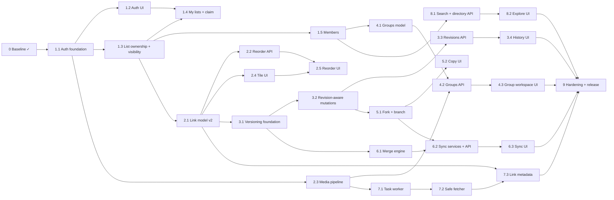

# 17: Implementation roadmap

How to use this document:

- **One task = one branch from `v2` = one PR into `v2`.** The branch name is given per task.
  Tick the task's box in the PR that completes it.
- Every task names the specs to read first. Every PR meets the definition of done in
  [CLAUDE.md](../../CLAUDE.md#definition-of-done-for-every-v2-pr).
- Sizes are rough: **S** ≤ 1 day, **M** 2–3 days, **L** 4–5 days. A task that grows beyond L
  is split before it is started.
- Phases are coherent, testable increments of the `v2` codebase (staging), not production
  releases. Production moves from V1 to V2 once, in phase 9 ([06](06-MIGRATION-PLAN.md)).
- The order follows technical dependencies. It is not a waterfall: the lanes below run in
  parallel wherever the dependency graph allows.

## Dependency graph and parallel lanes

| Lane | Can run in parallel with | Notes |
|---|---|---|
| A: accounts and ownership (1.x) | 1.6 dependency refresh, 2.3 media | 1.1 first, since everything with a user FK depends on it |
| B: links and tiles (2.x) | 1.4, 1.5 | 2.1 is the gate for revisions and metadata |
| C: revisions → fork/branch → sync (3, 5, 6) | 4.x, 7.x, 8.x | 6.1 (pure engine) can start as soon as 3.1 fixes the snapshot schema |
| D: groups (4.x) | 3.x, 5.x, 6.x | needs 1.5 (roles) and 2.3 (images) |
| E: metadata (7.x) | 3.x–6.x | needs 2.1 and 2.3 |
| F: discovery (8.x) | 3.x–7.x | needs 1.3 and 1.5 (visibility, verified-email gate) |

**Recommended first implementation PR: task 1.1 (`feature/accounts-foundation`).** The custom
user model must exist before the first migration that references users, and nearly every
other task depends on it. It is backend-only and leaves the V1 UI and API working unchanged
(DRF views are CSRF-exempt unless `SessionAuthentication` applies, and V1 uses bearer tokens).

---

## Phase 0: Repository and baseline

**Goal:** a safe `v2` branch, a verified V1 baseline, and complete planning documentation.
**Status:** complete (2026-10-28).

- [x] **0.1** Create `v2` from `main` at `fb5f901`. Inspect Git state ([01](01-V1-AUDIT.md#repository-and-git)).
- [x] **0.2** V1 audit, test baseline (129 backend tests, frontend checks green), `docs/v2/`, `CLAUDE.md`, ADRs.
- [x] **0.3** Push `v2` (`95cb878`); CI guard in `ci.yml` (target check + `v2` push trigger); rulesets on `main` and `v2`. Verified 2026-10-28: rulesets 26061515 (`main`) and 26061516 (`v2`) are enforced, and CI run 40736258527 on `v2` passed `checks`, `proxy` and `e2e` ([16](16-GIT-WORKFLOW.md#enforcement-status)).

---

## Phase 1: Accounts, ownership and visibility

**Goal:** users can sign up and sign in, create lists that they own, and choose who sees each
list. V1 lists keep working through their edit links and can be claimed.
**Dependencies:** phase 0. **Read:** [ADR-007](adr/ADR-007-authentication-and-ownership-migration.md),
[ADR-011](adr/ADR-011-accounts-required-legacy-lists.md), [12](12-AUTHORIZATION.md),
[06](06-MIGRATION-PLAN.md#ownership-transition), [09](09-API-DESIGN.md).

| Area | Work |
|---|---|
| Backend | `accounts` app, allauth headless, sessions, CSRF, `/api/v2/` skeleton with the exception handler, `sharing/policy.py`, `ListViewSet`, legacy bearer principal, claim, memberships |
| Frontend | split API client (CSRF, session), `useSession`, auth screens, My lists (owned, shared, on this device), claim, Share dialog with visibility and people, copy rewrite |
| Database | `accounts_user` + contrib tables + allauth; list ownership, visibility, description, slug, `allow_*`, tags, `creation_key`; `ListMembership`; CHECKs L2 and L3 |
| Infrastructure | email settings (console in dev); Mailpit in the dev and e2e stacks; nginx and Vite route `/_allauth/`; `DB_STATEMENT_TIMEOUT` override for `migrate` |
| Tests | auth flows, CSRF, the permission matrix (lists), leak tests, migration test on V1-shaped data, v1 create → 410, e2e: signed-in create, legacy claim |

| Task | Branch | Scope | Depends on | Size |
|---|---|---|---|---|
| [x] **1.1** Auth foundation | `feature/accounts-foundation` | contrib auth, contenttypes, sessions; `CsrfViewMiddleware`; `accounts.User` in `0001_initial` + `AUTH_USER_MODEL`; allauth headless (browser, email login, email verification optional, enumeration prevention); session and CSRF cookie settings; remove the W003 silence; `GET /api/v2/session/`, `PATCH /api/v2/me/`; v2 URL namespace + domain-error exception handler; `migrate` statement-timeout override | 0 | M |
| [x] **1.2** Auth UI | `feature/auth-ui` | `api/client.ts` split (CSRF, `same-origin` credentials, `code` on `ApiError`), `useSession`, routes and guards (`next` validation), sign in/up, verify, reset, account (no deletion yet), nav and account menu; Mailpit; e2e auth flows | 1.1 | M |
| [x] **1.3** List ownership and visibility | `feature/list-ownership` | list fields + migration (V1 rows → unlisted legacy lists, slugs backfilled) + CHECKs L2/L3; `ListMembership` model; pure `policy.py` (+ visibility filtering in selectors); `ListViewSet` (list, create, retrieve, update, destroy, rotate-token) with `Idempotency-Key`; legacy bearer on v2; V1 reads and `/r/` respect visibility; verified email required for `public`; slug (`/l/{code}/{slug}`). **V1 create retirement moved to 1.4**, so the create form and the V1 e2e suite keep working until the signed-in create UI lands | 1.1 | L |
| [ ] **1.4** My lists and claim | `feature/my-lists-claim` | `POST …/claim/`; **v1 create → 410** and e2e seeding through the API/fixtures instead of anonymous create (moved from 1.3); My lists tabs; "Add to my account" (single and bulk); signed-in create; signed-out landing; "Keep permanently?" prompt; Share dialog visibility selector; rewrite of the 30-day copy; e2e: replace `create.spec`, add the legacy-claim journey | 1.2, 1.3 | L |
| [ ] **1.5** Members | `feature/list-members` | members API (add by email, roles, remove, leave), `permissions` in representations, People section, full list matrix tests | 1.3 | M |
| [ ] **1.6** Dependency refresh | `chore/drf-3-18` | DRF 3.16 → 3.18 and other minor updates after reading the release notes; all V1 tests green | 0 | S |
| [ ] **1.7** Account deletion | `feature/account-deletion` | `DELETE /api/v2/me/` (owned lists and groups deleted first, type-to-confirm), UI | 1.4 | S |

**Acceptance criteria:** a new user can sign up, verify, create a private list and share it as
unlisted. Anonymous users can't create lists. A V1 edit link still edits its list and can be
claimed exactly once. Private lists return 404 everywhere for outsiders. Every V1 regression
test is green or replaced as listed in [15](15-TEST-STRATEGY.md#v1-regression-checklist).
**Risks:** auth misconfiguration (CSRF or cookies) → covered by API tests and deploy checks.
The legacy principal leaking onto claimed lists → explicit tests.
**Definition of done:** all of the above, plus the policy matrix test for lists, the v1 API
compatibility tests, and the e2e suite in all five projects.

---

## Phase 2: Links as tiles

**Goal:** links get identity-preserving soft deletion, a stored order, descriptions and icons,
and the list page shows tiles with accessible reordering.
**Dependencies:** 1.3. **Read:** [04](04-DOMAIN-MODEL.md#link-sharingsharedlink),
[05](05-DATABASE-DESIGN.md#sharing_sharedlink-existing-extended), [ADR-005](adr/ADR-005-child-ordering-policy.md),
[ADR-012](adr/ADR-012-media-and-images.md), [ADR-013](adr/ADR-013-soft-delete-links-only.md), [11](11-UI-UX-MIGRATION.md#list-page).

| Task | Branch | Scope | Depends on | Size |
|---|---|---|---|---|
| [ ] **2.1** Link model v2 | `feature/link-model-v2` | link columns, position backfill (newest-first → 0..n-1), swap to the partial unique index, deferrable position unique, tombstone CHECK, live-source unique index; services: append, tombstone with compaction, `creation_key`; `LinkViewSet`; v1 endpoints mapped onto the same services (v1 ordering kept); tombstoned short URL → 404 | 1.3 | L |
| [ ] **2.2** Reorder API | `feature/link-reorder` | `POST …/reorder/` (move), `move-to-list` (two locks in id order), concurrency tests | 2.1 | M |
| [ ] **2.3** Media pipeline | `feature/media-pipeline` | Pillow, `MEDIA_*`, `media` volume, nginx `/media/` headers, per-route upload limits (Django + nginx), list image and link icon endpoints, `cleanup_media`, image security tests, smoke-test additions | 1.1 | M |
| [ ] **2.4** Tile UI | `feature/tile-ui` | `LinkTile`, `LinkGrid`, `ViewToggle`, split `ListView.vue`, `LinkForm` description and icon, Details, `display` precedence | 2.1 | L |
| [ ] **2.5** Reorder UI | `feature/reorder-ui` | one-day spike (vue-draggable-plus on the phone projects), drag reorder, ⋮ Move items, live region, e2e scenario 4 | 2.2, 2.4 | M |

**Acceptance:** the order persists and is identical for all viewers. Moves under concurrency
never lose updates. Deleting a link keeps its row (tombstone), and its short URL answers 404.
Reordering is fully possible without dragging. **Risks:** mobile drag-and-drop breakage (the
spike, plus the Move menu as a guaranteed path). The constraint swap migration (tested on
V1-shaped data).

---

## Phase 3: Revision history

**Goal:** every content change is versioned atomically, and users can browse and restore
versions. **Dependencies:** 2.1. **Read:** [07](07-REVISION-SPEC.md), [ADR-003](adr/ADR-003-immutable-revision-snapshots.md).

| Task | Branch | Scope | Depends on | Size |
|---|---|---|---|---|
| [ ] **3.1** Versioning foundation | `feature/versioning-foundation` | `versioning` app; `ListRevision`; immutability trigger; `versioning/domain/snapshot.py` (schema v1, builder, validator, upcaster hook); `head_revision`; baseline `migrated` revisions (batched data migration); the domain-import AST test | 2.1 | M |
| [ ] **3.2** Revision-aware mutations | `feature/revision-aware-mutations` | `record_revision` inside every content mutation (including legacy writes and moves), no-op detection, `ETag`/`If-Match`, R1–R4 tests including concurrency and forced-failure tests | 3.1 | L |
| [ ] **3.3** Revisions API | `feature/revisions-api` | list, detail with diff, restore (revive, tombstone, reposition) with the required `If-Match` | 3.2 | M |
| [ ] **3.4** History UI | `feature/history-ui` | `/l/:code/history`, timeline, diff, restore confirm, e2e scenario 6 | 3.3 | M |

**Acceptance:** the R1–R5 invariant tests pass, including 20 concurrent writers. A restore
revives links with the same short URLs. **Risks:** revisions diverging from the live state
(R4 property test). Snapshot size (measured. The cap keeps it small).

---

## Phase 4: Groups

**Goal:** workspaces of lists with a responsive sidebar, which never leak hidden lists.
**Dependencies:** 1.5, 2.3. **Read:** [12](12-AUTHORIZATION.md#which-lists-a-group-shows-to-a-viewer), [11](11-UI-UX-MIGRATION.md#groups-workspace).

| Task | Branch | Scope | Depends on | Size |
|---|---|---|---|---|
| [ ] **4.1** Groups model | `feature/groups-model` | `Group`, `GroupList`, `GroupMembership`, constraints, group code generation (V1 helper), policy extension (group roles, display rule in SQL), services with locks | 1.5 | M |
| [ ] **4.2** Groups API | `feature/groups-api` | `GroupViewSet` + lists, reorder, members, image; leak tests (public group × private, unlisted and public lists × viewer types) | 4.1, 2.3 | M |
| [ ] **4.3** Group workspace UI | `feature/group-workspace-ui` | Groups page, `/g/:code`, `GroupSidebar` (permanent, rail or temporary; verify the Vuetify 4 drawer props), list picker, sidebar reorder (reuses 2.5), e2e scenario 3 | 4.2, 2.5 | L |

**Acceptance:** every case in the group display-rule tests passes. Counts never reveal hidden
lists. Keyboard and screen-reader navigation of the sidebar works on desktop and phone.

---

## Phase 5: Fork and branch

**Goal:** "Make a copy" and "Make a synced copy" create independent lists atomically.
**Dependencies:** 3.2. **Read:** [08 Fork vs branch](08-SYNCHRONIZATION-SPEC.md#fork-vs-branch).

| Task | Branch | Scope | Depends on | Size |
|---|---|---|---|---|
| [ ] **5.1** Fork and branch | `feature/fork-and-branch` | `ListBranch` (+ `parent_deleted_at`), `forked_from_id`, creation from the parent's head snapshot (links, codes, `source_link_id`, copied metadata, revision 1), fork, branches and detach endpoints, `Idempotency-Key`; delete-list and `cleanup_expired` set `parent_deleted_at`; atomicity and permission tests | 3.2 | M |
| [ ] **5.2** Copy UI | `feature/copy-ui` | `CopyListDialog`, `allow_fork`/`allow_branch` settings, provenance banner, "synced copies of this list" | 5.1 | M |

---

## Phase 6: Synchronization

**Goal:** a reviewed three-way merge from the parent with Use update / Keep mine / Ignore,
exactly as specified. **Dependencies:** 3.1 (engine), 5.1 (services). **Read:**
[08](08-SYNCHRONIZATION-SPEC.md) (all of it), [ADR-004](adr/ADR-004-three-way-merge.md).

| Task | Branch | Scope | Depends on | Size |
|---|---|---|---|---|
| [ ] **6.1** Merge engine | `feature/merge-engine` | pure `versioning/domain/merge.py`: classification, two-way re-inclusion, the URL guard and adopt, decision application plan, change ids, fingerprint, `engine_version`; 36 scenario tests; Hypothesis properties; 100 % branch coverage; timing check | 3.1 | L |
| [ ] **6.2** Sync services and API | `feature/sync-services` | `BranchExclusion`, `SyncRecord`; `sync_status`; preview; apply (lock, idempotency, fingerprint, decision validation, ordered application, URL cycle parking, base advance, exclusions); remove exclusion; endpoints and error codes; concurrency tests | 6.1, 5.1 | L |
| [ ] **6.3** Sync UI | `feature/sync-ui` | sync chip, Review updates page (sections, `FieldCompare`, `DecisionGroup`), apply flow with idempotency key, stale, failure and success states, ignored-links panel, e2e scenarios 1 and 9 | 6.2 | L |

**Acceptance:** every catalogue scenario passes at engine level. The risky subset passes
through the API. Duplicate and concurrent applies behave as specified. The e2e journey passes
in all five projects. **Risks:** this is the highest-risk phase ([18](18-RISKS-AND-MITIGATIONS.md)).
No shortcuts on decisions, baselines or idempotency.

---

## Phase 7: Metadata extraction

**Goal:** titles, descriptions and icons fill in automatically, safely, and never over user
input. **Dependencies:** 2.1, 2.3. **Read:** [ADR-008](adr/ADR-008-background-metadata-extraction.md), [13 SSRF](13-SECURITY.md#ssrf-safe-fetcher).

| Task | Branch | Scope | Depends on | Size |
|---|---|---|---|---|
| [ ] **7.1** Task worker | `feature/task-worker` | django-tasks + django-tasks-db (pinned), `TASKS` settings, `worker` service (dev and prod compose), worker healthcheck, `prune_db_task_results` in crontab, egress hardening notes in the deployment docs; fallback decision recorded if the library disappoints | 2.3 | M |
| [ ] **7.2** Safe fetcher | `feature/safe-fetcher` | `metadata/fetcher.py` (resolve, validate, pin, manual redirects, limits), `parser.py`, the image pipeline for fetched images, tests with a local server and a stubbed resolver (rebinding) | 7.1 | L |
| [ ] **7.3** Link metadata | `feature/link-metadata` | enqueue on create and URL change (`on_commit`), conditional store, `refresh-metadata` endpoint + throttle, `display` + `metadata_status`, frontend suggestions and states, `backfill_metadata` command, e2e fixture site | 7.2, 2.1 | M |

---

## Phase 8: Discovery

**Goal:** public lists and groups are findable by text and tags, and nothing else ever is.
**Dependencies:** 1.3, 1.5. **Read:** [05 indexes](05-DATABASE-DESIGN.md#indexes-added-by-v2), [09 Directory](09-API-DESIGN.md#directory).

| Task | Branch | Scope | Depends on | Size |
|---|---|---|---|---|
| [ ] **8.1** Search and directory API | `feature/search-index` | `pg_trgm`, generated search column (verify the Django expression, otherwise a trigger), GIN indexes, tag validation and editing, directory endpoints, throttles, leak tests | 1.5 | M |
| [ ] **8.2** Explore UI | `feature/explore-ui` | `/explore`, search, tag chips, sort, empty states, tag editing in settings | 8.1 | M |

---

## Phase 9: Hardening and release

**Goal:** V2 is secure, fast, accessible, documented and released without losing V1.
**Dependencies:** everything above.

| Task | Branch | Scope | Size |
|---|---|---|---|
| [ ] **9.1** Security review | `chore/security-review` | an ASVS 5.0 L1/L2 pass over auth, session, access control, files and SSRF [R14]; dependency audit; fix findings | M |
| [ ] **9.2** Performance review | `chore/performance-review` | query counts and timings against [14 targets](14-INFRASTRUCTURE.md#performance-targets-initial), indexes, snapshot sizes | S |
| [ ] **9.3** Accessibility review | `chore/a11y-review` | extend and run the manual QA checklist (VoiceOver, NVDA, phones); axe on every page | M |
| [ ] **9.4** Documentation | `docs/v2-release` | root README for V2 (V1 README moved to `docs/v1/`), API docs, deployment (worker, media, email, backups), `docs/v2` brought up to date | M |
| [ ] **9.5** Rehearsal and release | `chore/release-v2` | staging restore + migration timing + rollback drill; reconcile `main` → `v2`; `release/v1` + `v1.0.0`; release PR `v2 → main`; deploy per [06](06-MIGRATION-PLAN.md#deployment-strategy-release-day) | M |
| [ ] **9.6** Legacy sunset (≥30 days after launch) | `chore/legacy-sunset` | remove `/api/v1/`, the legacy principal, backup and edit-link UI; contract migration (`owner_token_hash`, CHECK L2) | S |

**Definition of done for V2:** every acceptance criterion above, all CI jobs green on `v2`, the
release rehearsal executed with a written result, and rollback verified on staging.
